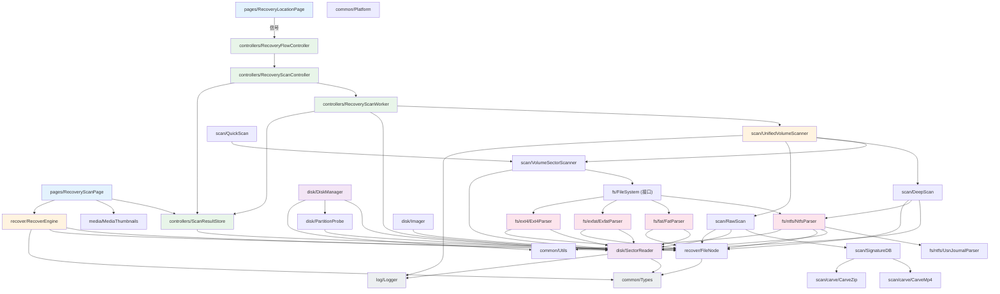
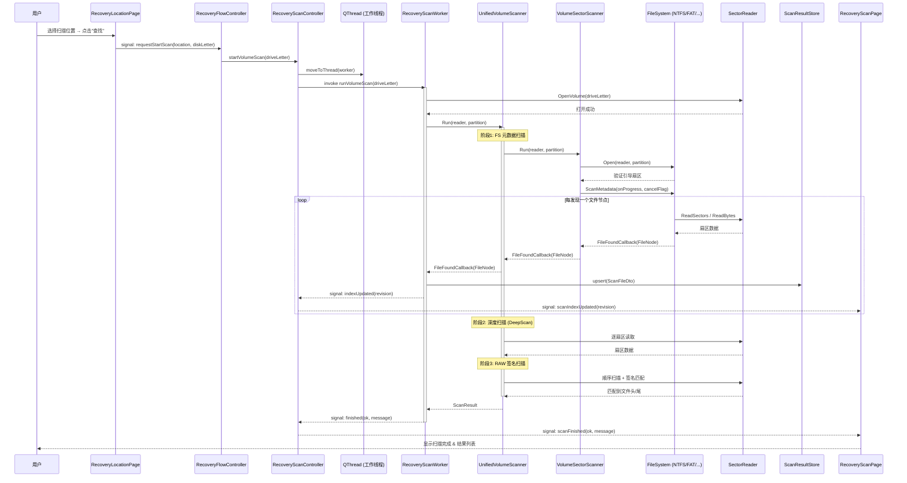
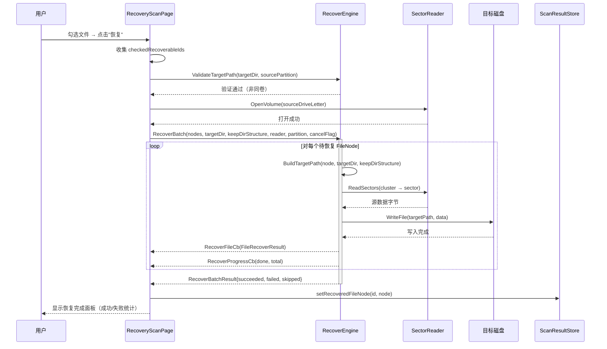
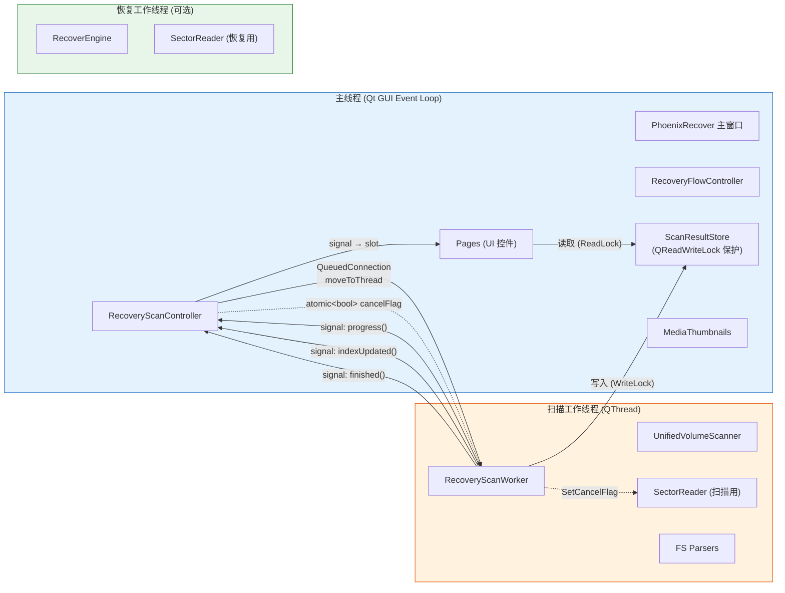

# PhoenixRecover 架构设计文档

> **文档版本**: 1.0  
> **最后更新**: 2026-05-26  
> **维护者**: 技术负责人  

---

## 1. 项目概述

### 1.1 产品定位

**PhoenixRecover** 是一款面向 Windows 桌面平台的专业数据恢复软件，支持从已删除、格式化、分区损坏等场景中恢复文件。产品对标 **EaseUS Data Recovery Wizard** 等头部商业恢复工具，目标是在合理时间内提供可浏览、可过滤的候选文件列表，并完成数据恢复。

### 1.2 对标产品

| 对标产品 | 对标维度 |
|----------|----------|
| EaseUS Data Recovery Wizard | 扫描体验、恢复成功率、单一扫描入口 |
| Recuva (Piriform) | 轻量快速扫描 |
| R-Studio | 深度 RAW/签名恢复能力 |

### 1.3 技术栈

| 领域 | 选型 | 说明 |
|------|------|------|
| 语言 | **C++17** | 高性能底层 I/O、文件系统解析 |
| UI 框架 | **Qt 5.14+ (Widgets)** | 跨平台桌面 GUI，AUTOMOC/AUTORCC/AUTOUIC |
| 构建系统 | **CMake 3.16+** | 主构建系统；保留 `.vcxproj` 兼容 |
| 编译器 | **MSVC** (Windows 主力) | 支持 `/utf-8`；未来 GCC/Clang 扩展 |
| 媒体处理 | **FFmpeg** (QProcess 调用) | 视频缩略图生成，许可证边界清晰 |
| 平台 API | **Win32 API** | `CreateFile`、`DeviceIoControl` 用于卷/扇区访问 |
| 可选三方 | **The Sleuth Kit (TSK)** | 可选 FS 元数据后端，默认不链接 |
| 测试框架 | **CTest** | 单元测试与回归测试 |

---

## 2. 目录结构说明

```
PhoenixRecover/
├── main.cpp                    # 程序入口
├── PhoenixRecover.cpp/.h       # 主窗口/路由层（QStackedWidget 页面容器）
├── CMakeLists.txt              # CMake 主构建脚本
├── PhoenixRecover.qrc          # Qt 资源文件
├── PhoenixRecover.ui           # Qt Designer UI 文件
│
├── common/                     # 公共基础层
│   ├── Platform.h              #   编译期平台宏定义（PHOENIX_OS_*）
│   ├── Types.h                 #   公共类型（ErrorCode、RecoverabilityLevel、FileStatus、ScanMode）
│   ├── Utils.h/.cpp            #   工具函数（字符串转换、二进制读取、文件系统助手）
│   └── SysInfo.h/.cpp          #   系统信息收集（OS、CPU、RAM、GPU）
│
├── controllers/                # 控制层（业务流程与状态管理）
│   ├── RecoveryFlowController.h/.cpp    #   总流程控制器（连接 UI 意图与业务动作）
│   ├── RecoveryScanController.h/.cpp    #   扫描控制器（管理工作线程、信号转发）
│   ├── RecoveryScanWorker.h/.cpp        #   扫描工作线程（QThread 中运行实际扫描）
│   ├── ScanResultStore.h/.cpp           #   扫描结果存储（线程安全、索引、分页）
│   └── ScanTypes.h                      #   扫描相关 DTO（ScanFileDto、ScanPreviewKind）
│
├── disk/                       # I/O 层（设备与扇区访问）
│   ├── DiskManager.h/.cpp      #   物理磁盘枚举、镜像加载
│   ├── SectorReader.h/.cpp     #   扇区级只读 I/O（支持超时、重试、坏扇区处理）
│   ├── PartitionProbe.h/.cpp   #   分区探测（MBR/GPT/签名扫描）
│   ├── Partition.h             #   分区数据结构
│   ├── PhysicalDisk.h          #   物理磁盘数据结构（含 SMART 健康信息）
│   ├── Imager.h/.cpp           #   磁盘镜像创建
│   ├── SmartInfo.h/.cpp        #   S.M.A.R.T. 健康查询
│   └── BadSectorMap.h          #   坏扇区记录映射
│
├── fs/                         # 文件系统解析层
│   ├── FileSystem.h            #   抽象文件系统接口（Open/ScanMetadata/GetAllFiles）
│   ├── ntfs/                   #   NTFS 解析器
│   │   ├── NtfsParser.h/.cpp   #     MFT 解析、数据运行解码、路径构建
│   │   ├── NtfsStructs.h       #     NTFS 磁盘结构体定义
│   │   └── UsnJournalParser.h/.cpp  #  USN 变更日志解析
│   ├── fat/                    #   FAT12/16/32 解析器
│   │   ├── FatParser.h/.cpp    #     FAT 目录遍历、簇链构建
│   │   └── FatStructs.h        #     FAT 磁盘结构体定义
│   ├── exfat/                  #   exFAT 解析器
│   │   ├── ExfatParser.h/.cpp  #     exFAT 目录遍历、分配位图
│   │   └── ExfatStructs.h      #     exFAT 磁盘结构体定义
│   └── ext4/                   #   ext4 解析器
│       ├── Ext4Parser.h/.cpp   #     ext4 inode/extent/块组遍历
│       └── Ext4Structs.h       #     ext4 磁盘结构体定义
│
├── scan/                       # 扫描引擎层
│   ├── ScanEngine.h            #   抽象扫描引擎基类（回调、取消、进度）
│   ├── UnifiedVolumeScanner.h/.cpp  #  统一卷扫描器（对外唯一入口）
│   ├── VolumeSectorScanner.h/.cpp   #  卷扇区级扫描器（创建并调度 FS 解析器）
│   ├── QuickScan.h/.cpp        #   快速扫描（FS 元数据为主）
│   ├── DeepScan.h/.cpp         #   深度扫描（逐扇区 MFT/FAT 目录发现）
│   ├── RawScan.h/.cpp          #   RAW 签名扫描（文件雕刻）
│   ├── SignatureDB.h/.cpp      #   文件签名数据库
│   ├── ScanSerializer.h/.cpp   #   扫描结果序列化/持久化
│   └── carve/                  #   特定格式雕刻器
│       ├── CarveMp4.h/.cpp     #     MP4/MOV 容器雕刻
│       └── CarveZip.h/.cpp     #     ZIP 容器雕刻
│
├── recover/                    # 恢复引擎层
│   ├── RecoverEngine.h/.cpp    #   文件恢复引擎（单文件/批量恢复、预览读取）
│   └── FileNode.h              #   核心文件节点结构（所有扫描引擎共用）
│
├── media/                      # 媒体预览层
│   ├── MediaThumbnails.h/.cpp  #   统一缩略图接口
│   ├── FfmpegVideoThumb.h/.cpp #   FFmpeg 视频缩略图（跨平台）
│   ├── WinShellVideoThumb.h/.cpp  # Windows Shell 视频缩略图
│   └── WinWicImageDecoder.h/.cpp  # Windows WIC 图像解码
│
├── pages/                      # UI 页面层（Qt Widgets）
│   ├── RecoveryLocationPage.h/.cpp    #  位置选择页（回收站/桌面/文件夹/磁盘）
│   ├── RecoveryScanPage.h/.cpp        #  扫描结果展示页（树状目录/类型/表格/网格）
│   ├── SDCardConnectionPage.h/.cpp    #  SD 卡连接引导页
│   └── MoreRecoveryToolsPage.h/.cpp   #  更多恢复工具页
│
├── log/                        # 日志子系统
│   └── Logger.h/.cpp           #   单例日志器（分级、文件/控制台双输出、宏封装）
│
├── tests/                      # 测试目录
│   ├── CMakeLists.txt          #   测试构建脚本
│   └── test_utils_numeric.cpp  #   工具函数单元测试
│
├── docs/                       # 项目文档
│   ├── TECHNICAL_PLAN.md       #   技术方案与路线图
│   ├── ARCHITECTURE.md         #   架构设计文档（本文件）
│   └── ...                     #   其他文档
│
├── testdata/                   # 测试数据（镜像、清单）
├── third_party/                # 第三方依赖占位
└── ffmpeg-master-latest-win64-gpl-shared/  # FFmpeg 预编译二进制
```

---

## 3. 分层架构图

项目采用严格的分层架构，从上到下依次为 UI 层、控制层、引擎层、文件系统层、I/O 层和公共层。**上层只依赖下层，禁止反向依赖。**

```mermaid
flowchart TB
    subgraph UI["UI 层 (pages/)"]
        direction LR
        RLP["RecoveryLocationPage<br/>位置选择"]
        RSP["RecoveryScanPage<br/>扫描结果展示"]
        SCP["SDCardConnectionPage<br/>SD卡引导"]
        MRP["MoreRecoveryToolsPage<br/>更多工具"]
    end

    subgraph CTRL["控制层 (controllers/)"]
        direction LR
        RFC["RecoveryFlowController<br/>总流程控制"]
        RSC["RecoveryScanController<br/>扫描控制"]
        RSW["RecoveryScanWorker<br/>扫描工作线程"]
        SRS["ScanResultStore<br/>结果存储"]
    end

    subgraph ENGINE["引擎层 (scan/ + recover/)"]
        direction LR
        UVS["UnifiedVolumeScanner<br/>统一扫描入口"]
        QS["QuickScan<br/>快速扫描"]
        DS["DeepScan<br/>深度扫描"]
        RS["RawScan<br/>RAW签名扫描"]
        RE["RecoverEngine<br/>恢复引擎"]
    end

    subgraph FS["文件系统层 (fs/)"]
        direction LR
        FSI["FileSystem 接口"]
        NTFS["NtfsParser"]
        FAT["FatParser"]
        EXFAT["ExfatParser"]
        EXT4["Ext4Parser"]
    end

    subgraph IO["I/O 层 (disk/)"]
        direction LR
        DM["DiskManager<br/>磁盘枚举"]
        SR["SectorReader<br/>扇区读取"]
        PP["PartitionProbe<br/>分区探测"]
        IMG["Imager<br/>磁盘镜像"]
    end

    subgraph COMMON["公共层 (common/ + log/)"]
        direction LR
        PLT["Platform.h<br/>平台宏"]
        TYP["Types.h<br/>公共类型"]
        UTL["Utils<br/>工具函数"]
        LOG["Logger<br/>日志系统"]
        SYS["SysInfo<br/>系统信息"]
    end

    UI --> CTRL
    CTRL --> ENGINE
    ENGINE --> FS
    ENGINE --> IO
    FS --> IO
    IO --> COMMON
    CTRL --> COMMON
    ENGINE --> COMMON

    style UI fill:#e3f2fd,stroke:#1565c0
    style CTRL fill:#e8f5e9,stroke:#2e7d32
    style ENGINE fill:#fff3e0,stroke:#e65100
    style FS fill:#fce4ec,stroke:#c62828
    style IO fill:#f3e5f5,stroke:#6a1b9a
    style COMMON fill:#eceff1,stroke:#37474f
```



### 分层职责详述

| 层次 | 目录 | 职责 | 约束 |
|------|------|------|------|
| **UI 层** | `pages/` | 界面展示、用户交互、信号发射 | 禁止调用业务逻辑；只通过信号表达用户意图 |
| **控制层** | `controllers/` | 流程编排、状态管理、线程调度 | 连接 UI 信号与引擎调用；管理 Worker 生命周期 |
| **引擎层** | `scan/`, `recover/` | 扫描算法、恢复读写、签名雕刻 | 纯逻辑计算，无 UI 依赖；通过回调报告进度 |
| **文件系统层** | `fs/` | FS 元数据解析（MFT、FAT、inode） | 只依赖 SectorReader 读取数据；输出 FileNode |
| **I/O 层** | `disk/` | 设备枚举、扇区读写、坏扇区处理 | 封装平台差异；对上层提供统一读取接口 |
| **公共层** | `common/`, `log/` | 类型定义、工具函数、日志、平台宏 | 无业务逻辑；被所有层引用 |

---

## 4. 模块依赖关系图



---

## 5. 数据流图

### 5.1 扫描流程



### 5.2 恢复流程



---

## 6. 线程模型图



### 线程通信机制详述

| 通信方式 | 使用场景 | 说明 |
|----------|----------|------|
| **Qt 信号槽 (QueuedConnection)** | Worker → Controller → UI | 扫描进度、文件发现、完成通知 |
| **std::atomic\<bool\>** | UI → Worker → SectorReader | 取消标志，无锁传递停止信号 |
| **QReadWriteLock** | Worker 写 / UI 读 ScanResultStore | 保护共享结果数据，允许并发读 |
| **moveToThread** | RecoveryScanController → Worker | Worker 对象移到独立 QThread 执行 |

### 线程安全约束

1. **主线程独占 UI 更新**：所有 QWidget 操作只在主线程执行
2. **Worker 线程不触碰 UI**：仅通过信号传递数据
3. **ScanResultStore 双锁模式**：写操作取 WriteLock，读操作取 ReadLock
4. **SectorReader 实例不跨线程共享**：每个线程持有独立的 Reader 实例
5. **取消响应 ≤ 2 秒**：`SectorReader` 读循环检查 `cancelFlag`，确保可及时中断

---

## 7. 核心数据结构

### 7.1 FileNode — 可恢复文件节点

所有扫描引擎的统一输出结构，同时被恢复引擎消费。

```cpp
struct FileNode {
    // ── 身份 ──
    uint64_t     id;              // 唯一 ID（NTFS: MFT 记录号; FAT: 序号; RAW: 起始偏移）
    std::wstring name;            // 文件名
    std::wstring originalPath;    // 卷上原始完整路径
    std::wstring extension;       // 小写扩展名 (e.g. L"jpg")

    // ── 元数据 ──
    uint64_t     size;            // 逻辑文件大小 (字节)
    uint64_t     createTime;      // 创建时间 (Windows FILETIME)
    uint64_t     modifyTime;      // 修改时间
    uint64_t     accessTime;      // 访问时间
    FileStatus   status;          // Deleted / Lost / Normal
    RecoverabilityLevel recoverability; // Excellent / Good / Poor / Lost / Unknown
    bool         isDirectory;
    std::wstring fsType;          // "NTFS" | "FAT32" | "exFAT" | "RAW" 等

    // ── 数据定位 ──
    std::vector<uint64_t> clusters;    // NTFS/FAT: 绝对簇号列表
    uint64_t     rawOffset;            // RAW 扫描: 卷内字节偏移
    uint64_t     rawSize;              // RAW 扫描: 数据大小
    std::vector<uint8_t> residentData; // NTFS 驻留文件: 内联数据

    // ── NTFS 压缩 ──
    bool     isNtfsCompressed;
    uint32_t compressionUnit;          // 压缩单元簇数 (通常 16)

    // ── 层级 ──
    uint64_t parentId;                 // 父节点 ID (0 = 根)
};
```

### 7.2 ScanFileDto — UI 线程轻量描述

由控制层从 `FileNode` 转换，在 UI 线程中使用，避免持有大对象。

```cpp
struct ScanFileDto {
    quint64 id;
    QString name;
    QString fullPath;
    QString relativePath;
    QString extension;
    QString fsType;
    qint64  sizeBytes;
    quint64 parentId;
    bool    isDirectory;
    bool    isDeleted;
    bool    isReconstructed;
    quint64 modifyTimeFt;

    ScanPreviewKind previewKind;       // None / ResidentBlob / VolumeSlice / FullNode
    quint64 previewVolumeOffset;
    quint32 previewReadLength;
};
```

### 7.3 ScanProgress — 扫描进度快照

```cpp
struct ScanProgress {
    uint64_t     scannedBytes;   // 已扫描字节
    uint64_t     totalBytes;     // 总字节
    uint32_t     foundCount;     // 已发现文件数
    int          percent;        // 0..100
    double       speedMBps;      // 扫描速度 (MB/s)
    std::wstring stageLabel;     // 当前阶段描述文本
};
```

### 7.4 RecoverBatchResult — 批量恢复结果

```cpp
struct RecoverBatchResult {
    uint32_t  succeeded;         // 成功恢复数
    uint32_t  failed;            // 失败数
    uint32_t  skipped;           // 跳过数
    bool      cancelled;         // 是否被用户取消
    std::vector<FileRecoverResult> details; // 逐文件详情
};

struct FileRecoverResult {
    const FileNode* node;
    RecoverStatus   status;      // Success / Failed / Skipped
    std::wstring    reason;      // 失败原因
    std::wstring    targetPath;  // 恢复目标路径
};
```

### 7.5 Partition — 分区描述

```cpp
struct Partition {
    int          index;
    int          physicalDiskIdx;
    uint64_t     startSector;    // 物理磁盘上的绝对扇区偏移
    uint64_t     totalSectors;
    uint64_t     sizeBytes;
    std::wstring fsType;         // "NTFS" | "FAT32" | "exFAT" | "RAW" | ...
    std::wstring driveLetter;    // "C:" (未挂载时为空)
    std::wstring label;
    bool         isActive;
    bool         isSystem;
};
```

### 7.6 ReadPolicy — 读取策略

```cpp
struct ReadPolicy {
    uint32_t maxRetries   = 3;      // 单扇区最大重试次数
    uint32_t timeoutMs    = 8000;   // 单次读取超时 (ms)
    uint32_t retryDelayMs = 50;     // 重试间隔 (ms)
    bool skipBadSectors   = true;   // true: 坏扇区填零继续; false: 首个坏扇区即停止
};
```

### 7.7 其他关键枚举

| 枚举 | 值 | 说明 |
|------|----|------|
| `RecoverabilityLevel` | Excellent / Good / Poor / Lost / Unknown | 可恢复性评估 |
| `FileStatus` | Deleted / Lost / Normal | 文件当前状态 |
| `ScanMode` | Quick / Deep / Raw | 扫描模式（内部调度用） |
| `ErrorCode` | Success / AccessDenied / ReadError / ... | 通用错误码 |
| `LogLevel` | Debug / Info / Warning / Error / Fatal | 日志级别 |
| `ScanPreviewKind` | None / ResidentBlob / VolumeSlice / FullNode | 预览数据来源类型 |

---

## 8. 构建系统

### 8.1 CMake 结构

```
CMakeLists.txt (根)
├── option: PHOENIX_BUILD_GUI (ON/OFF)
├── C++17 标准强制
├── Qt5 AUTOMOC/AUTORCC/AUTOUIC
├── PHOENIX_SOURCES (所有 .cpp 源文件)
├── PHOENIX_RESOURCES (.qrc + .ui)
├── target: PhoenixRecover (可执行)
│   ├── link: Qt5::Core, Qt5::Gui, Qt5::Widgets
│   └── link (WIN32): ole32, windowscodecs
├── add_subdirectory(tests)
└── 可选: PHOENIX_USE_TSK (默认 OFF，占位注释)
    └── find_path / find_library / target_link_libraries
```

### 8.2 构建选项

| 选项 | 默认值 | 说明 |
|------|--------|------|
| `PHOENIX_BUILD_GUI` | `ON` | 构建 Qt GUI 主程序；设为 OFF 时仅构建 tests 等无 Qt 目标 |
| `PHOENIX_USE_TSK` | `OFF` (注释中) | 可选 The Sleuth Kit 链接 |

### 8.3 构建命令

```bash
# 完整 GUI 构建
mkdir build && cd build
cmake .. -DCMAKE_PREFIX_PATH=/path/to/Qt/5.14.2/msvc2017_64
cmake --build . --config Release

# 仅单测（无 Qt 依赖）
mkdir build && cd build
cmake .. -DPHOENIX_BUILD_GUI=OFF
cmake --build . --config Release
ctest --output-on-failure
```

### 8.4 CTest 集成

- `enable_testing()` 在根 CMakeLists.txt 启用
- 测试代码位于 `tests/` 子目录
- 当前测试：`test_utils_numeric.cpp`（工具函数数值相关测试）
- 运行：`ctest --test-dir build` 或 `cmake --build build --target RUN_TESTS`

### 8.5 MSVC 特殊配置

```cmake
if(MSVC)
    target_compile_options(PhoenixRecover PRIVATE /utf-8)
endif()
```

确保源文件中的中文字符串正确编译。

### 8.6 Windows 特定链接

```cmake
if(WIN32)
    add_executable(PhoenixRecover WIN32 ...)  # 无控制台窗口
    target_link_libraries(PhoenixRecover PRIVATE ole32 windowscodecs)
endif()
```

- `ole32`: COM 初始化（Shell API、WIC）
- `windowscodecs`: Windows Imaging Component（图片解码）

---

## 9. 第三方依赖

### 9.1 必需依赖

| 依赖 | 版本要求 | 用途 | 引入方式 |
|------|----------|------|----------|
| **Qt 5** | ≥ 5.14 | UI 框架（Widgets）、跨平台基础（QString、QThread、信号槽） | `find_package(Qt5 5.14 REQUIRED COMPONENTS Core Gui Widgets)` |
| **FFmpeg** | 最新稳定版 (GPL-shared) | 视频缩略图生成 | 预编译二进制，QProcess 调用 `ffmpeg` 可执行文件 |

### 9.2 系统库 (Windows)

| 库 | 用途 |
|----|------|
| `ole32.dll` | COM 基础（Shell 缩略图、WIC 初始化） |
| `windowscodecs.dll` | WIC 图像解码（JPEG/PNG/TIFF 等） |
| `kernel32.dll` | 文件 I/O、`CreateFile`、`DeviceIoControl` |

### 9.3 可选依赖

| 依赖 | 状态 | 用途 | 许可证 | 集成方式 |
|------|------|------|--------|----------|
| **The Sleuth Kit (libtsk)** | 占位未启用 | 多 FS 统一元数据访问；与自研解析器交叉验证 | CPL/LGPL/IBM PL 混合 | CMake `option(PHOENIX_USE_TSK)` + 动态库 |
| **ntfs-3g / libntfs-3g** | 规划中 | Linux 上 NTFS 读取备选 | GPL | 需法务评审，可能进程隔离 |
| **e2fsprogs / libext2fs** | 规划中 | ext4 校验层 | GPL/LGPL | 评估中 |
| **spdlog** | 候选 | 替代自研 Logger（可选） | MIT | 直接集成 |
| **GoogleTest / Catch2** | 候选 | 单元测试框架 | BSD / BSL | `add_subdirectory` 或 FetchContent |

### 9.4 FFmpeg 集成说明

当前策略为 **QProcess 进程调用**，而非静态/动态链接 libav*：

```
ffmpeg-master-latest-win64-gpl-shared/
├── bin/
│   ├── ffmpeg.exe          # 视频缩略图生成
│   └── *.dll              # 运行时动态库
└── include/               # 头文件（预留直接链接用）
```

优势：
- 许可证边界清晰（独立进程，不直接链入闭源主程序）
- 无符号冲突风险
- 更新 FFmpeg 版本无需重编译主程序

### 9.5 第三方库引入流程

1. **必要性评审**：替代自研成本、许可证兼容性、包大小影响
2. **PoC 验证**：最小可编译示例 + 一条恢复路径联调
3. **CI 集成**：vcpkg/Conan/子模块版本钉死 + SBOM 记录
4. **回滚策略**：通过编译宏（`PHOENIX_HAVE_XXX`）或 CMake 选项控制开关

---

## 附录 A: 关键类关系速查

| 类 | 所在层 | 核心职责 |
|----|--------|----------|
| `RecoveryFlowController` | 控制 | 连接 UI 页面意图与底层扫描/恢复动作 |
| `RecoveryScanController` | 控制 | 管理 QThread + Worker，转发扫描信号到 UI |
| `RecoveryScanWorker` | 控制 | 在独立线程中调用 UnifiedVolumeScanner |
| `ScanResultStore` | 控制 | 线程安全的扫描结果存储与索引 |
| `UnifiedVolumeScanner` | 引擎 | 统一扫描入口（编排 Quick/Deep/Raw） |
| `VolumeSectorScanner` | 引擎 | 创建合适的 FS Parser 并执行元数据扫描 |
| `QuickScan` | 引擎 | 快速元数据扫描（委托 VolumeSectorScanner） |
| `DeepScan` | 引擎 | 逐扇区发现 MFT 记录/FAT 目录 |
| `RawScan` | 引擎 | 文件签名雕刻（独立于 FS 结构） |
| `RecoverEngine` | 引擎 | 从扇区/簇读取数据并写入目标文件 |
| `FileSystem` (接口) | FS | 统一文件系统抽象（Open/ScanMetadata/GetAllFiles） |
| `NtfsParser` | FS | NTFS MFT 解析、DataRun 解码、路径构建 |
| `FatParser` | FS | FAT12/16/32 目录遍历、簇链跟踪 |
| `ExfatParser` | FS | exFAT 解析（常用于 SD 卡） |
| `Ext4Parser` | FS | ext4 inode/extent/块组遍历 |
| `SectorReader` | I/O | 只读扇区 I/O（超时、重试、坏扇区跳过） |
| `DiskManager` | I/O | 物理磁盘枚举、镜像加载 |
| `PartitionProbe` | I/O | MBR/GPT/签名分区探测 |
| `Logger` | 公共 | 单例分级日志（控制台+文件） |

---

## 附录 B: 平台适配策略

`common/Platform.h` 定义编译期宏：

| 宏 | 平台 | 值 |
|----|------|---|
| `PHOENIX_OS_WINDOWS` | Windows | 1 |
| `PHOENIX_OS_LINUX_DESKTOP` | Linux (非 Android) | 1 |
| `PHOENIX_OS_MACOS` | macOS | 1 |

各层平台适配方案：

| 功能 | Windows | Linux | macOS |
|------|---------|-------|-------|
| 卷枚举 | `DiskManager` (Win32 API) | `lsblk`/`udev` (规划) | `diskutil`+IOKit (规划) |
| 原始读 | `\\.\PhysicalDriveN` | `/dev/sdX` | `/dev/rdiskN` |
| 图片解码 | WIC (`WinWicImageDecoder`) | QImage | QImage |
| 视频缩略 | Shell API + FFmpeg | FFmpeg | FFmpeg + qlmanage |

---

*本文档随工程演进持续更新，以代码实际实现为准。*
