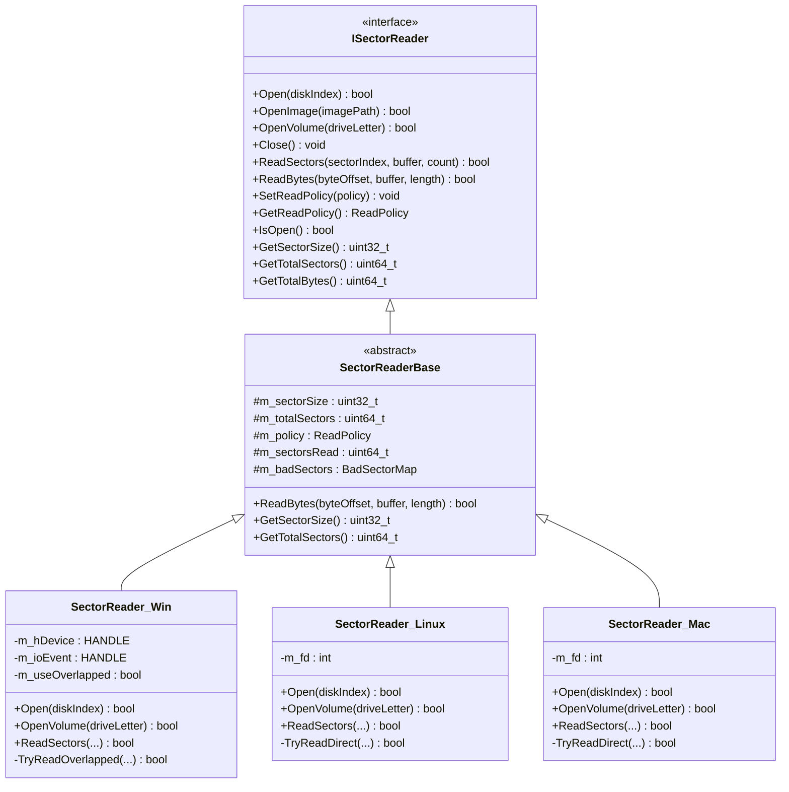
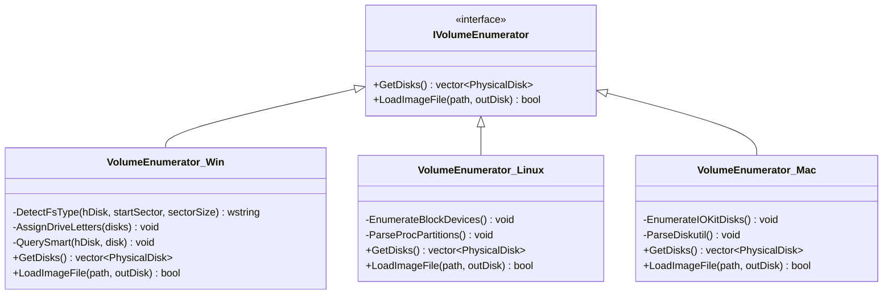

# 跨平台详细设计

> 文档版本：1.0  
> 最后更新：2026-05-26  
> 对应源码：`disk/SectorReader.h`、`disk/DiskManager.h`、`common/Platform.h`

---

## 1. 概述

### 1.1 平台优先级

| 优先级 | 平台 | 目标 | 现状 |
|--------|------|------|------|
| **P0** | Windows 10/11 | 完整功能，首要支持 | 已实现，使用 `CreateFile` + `DeviceIoControl` |
| **P1** | Linux (Ubuntu 22.04+, Fedora 38+) | 核心扫描与恢复 | 未实现，`disk/` 和 `recover/` 直接依赖 `<Windows.h>` |
| **P2** | macOS (13 Ventura+) | 核心扫描与恢复 | 未实现 |

### 1.2 设计原则

1. **接口抽象** — 提取平台无关的纯虚接口（`ISectorReader`、`IVolumeEnumerator`），业务层仅依赖接口
2. **编译隔离** — 每个平台的实现文件独立，通过 CMake 条件编译选择
3. **渐进迁移** — Windows 现有实现无需重写，仅提取接口并让现有类继承
4. **最小侵入** — 上层代码（`scan/`、`recover/`、`controllers/`、`pages/`）尽量不改动

### 1.3 现有平台宏

`common/Platform.h` 已定义以下宏，可直接在条件编译中使用：

```cpp
PHOENIX_OS_WINDOWS       // Q_OS_WIN
PHOENIX_OS_LINUX_DESKTOP // Q_OS_LINUX && !Q_OS_ANDROID
PHOENIX_OS_MACOS         // Q_OS_MACOS || Q_OS_MAC
```

---

## 2. 抽象接口设计

### 2.1 ISectorReader 接口

从现有 `SectorReader` 类提取纯虚接口，保留平台无关的公共方法在基类中。

```cpp
// disk/ISectorReader.h
#pragma once

#include <cstdint>
#include <functional>
#include <string>
#include <atomic>

struct ReadPolicy
{
    uint32_t maxRetries     = 3;
    uint32_t timeoutMs      = 8000;
    uint32_t retryDelayMs   = 50;
    bool     skipBadSectors = true;
};

class ISectorReader
{
public:
    using SectorReadCallback = std::function<void(uint64_t sectorsRead,
                                                   uint64_t totalSectors)>;
    virtual ~ISectorReader() = default;

    // ── 生命周期 ──
    virtual bool Open(int diskIndex) = 0;
    virtual bool OpenImage(const std::wstring &imagePath) = 0;
    virtual bool OpenVolume(const std::wstring &driveLetter) = 0;
    virtual void Close() = 0;

    // ── 读取 ──
    virtual bool ReadSectors(uint64_t sectorIndex, void *buffer,
                             uint32_t sectorCount = 1) = 0;
    virtual bool ReadBytes(uint64_t byteOffset, void *buffer,
                           uint32_t length) = 0;

    // ── 策略 ──
    virtual void              SetReadPolicy(const ReadPolicy &p) = 0;
    virtual const ReadPolicy &GetReadPolicy() const = 0;

    // ── 设备信息 ──
    virtual bool     IsOpen()          const = 0;
    virtual uint32_t GetSectorSize()   const = 0;
    virtual uint64_t GetTotalSectors() const = 0;
    virtual uint64_t GetTotalBytes()   const = 0;

    // ── 坏扇区统计 ──
    virtual uint64_t GetBadSectorCount() const = 0;
    virtual uint64_t GetSectorsRead()    const = 0;

    // ── 回调 ──
    virtual void SetSectorReadCallback(SectorReadCallback cb) = 0;
    virtual void SetCancelFlag(std::atomic<bool> *flag) = 0;
};
```

**与现有 `SectorReader` 的关系：**



### 2.2 IVolumeEnumerator 接口

从现有 `DiskManager` 提取设备枚举能力为独立接口。

```cpp
// disk/IVolumeEnumerator.h
#pragma once

#include "PhysicalDisk.h"
#include <vector>
#include <string>

class IVolumeEnumerator
{
public:
    virtual ~IVolumeEnumerator() = default;

    virtual std::vector<PhysicalDisk> GetDisks() = 0;
    virtual bool LoadImageFile(const std::wstring &imagePath,
                               PhysicalDisk &outDisk) = 0;
};
```

**类层次结构：**



### 2.3 平台工厂

```cpp
// disk/PlatformFactory.h
#pragma once

#include <memory>

class ISectorReader;
class IVolumeEnumerator;

class PlatformFactory
{
public:
    static std::unique_ptr<ISectorReader>       CreateSectorReader();
    static std::unique_ptr<IVolumeEnumerator>   CreateVolumeEnumerator();
};
```

实现中根据编译宏返回对应平台实例：

```cpp
// disk/PlatformFactory.cpp
#include "PlatformFactory.h"
#include "../common/Platform.h"

#if PHOENIX_OS_WINDOWS
#include "SectorReader_win.h"
#include "VolumeEnumerator_win.h"
#elif PHOENIX_OS_LINUX_DESKTOP
#include "SectorReader_linux.h"
#include "VolumeEnumerator_linux.h"
#elif PHOENIX_OS_MACOS
#include "SectorReader_mac.h"
#include "VolumeEnumerator_mac.h"
#endif

std::unique_ptr<ISectorReader> PlatformFactory::CreateSectorReader()
{
#if PHOENIX_OS_WINDOWS
    return std::make_unique<SectorReader_Win>();
#elif PHOENIX_OS_LINUX_DESKTOP
    return std::make_unique<SectorReader_Linux>();
#elif PHOENIX_OS_MACOS
    return std::make_unique<SectorReader_Mac>();
#endif
}

std::unique_ptr<IVolumeEnumerator> PlatformFactory::CreateVolumeEnumerator()
{
#if PHOENIX_OS_WINDOWS
    return std::make_unique<VolumeEnumerator_Win>();
#elif PHOENIX_OS_LINUX_DESKTOP
    return std::make_unique<VolumeEnumerator_Linux>();
#elif PHOENIX_OS_MACOS
    return std::make_unique<VolumeEnumerator_Mac>();
#endif
}
```

---

## 3. 各平台实现

### 3.1 Windows（现有实现迁移）

**SectorReader_Win：**

| 功能 | API | 说明 |
|------|-----|------|
| 打开物理磁盘 | `CreateFileW(L"\\\\.\\PhysicalDriveN", GENERIC_READ, FILE_SHARE_READ\|FILE_SHARE_WRITE, ...)` | 需管理员权限 |
| 打开逻辑卷 | `CreateFileW(L"\\\\.\\D:", ...)` | 需管理员权限 |
| 打开镜像文件 | `CreateFileW(path, ...)` | 同步模式，无需 OVERLAPPED |
| 读取扇区 | `ReadFile` + `OVERLAPPED` + `WaitForSingleObject(timeout)` | 超时重试机制 |
| 查询几何 | `IOCTL_DISK_GET_DRIVE_GEOMETRY_EX` | 获取扇区大小和总扇区数 |
| 取消 I/O | `CancelIo(m_hDevice)` | 配合 `std::atomic<bool>` cancel flag |

**VolumeEnumerator_Win（现有 `DiskManager` 迁移）：**

| 功能 | API |
|------|-----|
| 枚举物理磁盘 | 遍历 `\\.\PhysicalDrive0..15` + `IOCTL_DISK_GET_DRIVE_LAYOUT_EX` |
| 分区信息 | `PARTITION_INFORMATION_EX` 结构 |
| 盘符映射 | `IOCTL_VOLUME_GET_VOLUME_DISK_EXTENTS` |
| 文件系统检测 | 读取 Boot Sector 魔数判断 |
| SMART | `IOCTL_STORAGE_PREDICT_FAILURE` |

### 3.2 Linux 实现

**SectorReader_Linux：**

```
打开：
  物理磁盘 → open("/dev/sdX", O_RDONLY | O_DIRECT)
  分区     → open("/dev/sdX1", O_RDONLY | O_DIRECT)
  镜像文件 → open(path, O_RDONLY)

读取：
  pread(fd, aligned_buffer, sector_count * sector_size, sector_index * sector_size)

  注意：
  - O_DIRECT 要求 buffer 和 offset 均按 sector_size 对齐
  - 使用 posix_memalign() 或 aligned_alloc() 分配对齐缓冲区
  - 坏扇区处理：read 返回 -1 && errno == EIO → 零填充 + 记录

查询几何：
  ioctl(fd, BLKSSZGET, &sectorSize)     // 逻辑扇区大小
  ioctl(fd, BLKGETSIZE64, &totalBytes)  // 总字节数
  totalSectors = totalBytes / sectorSize

权限：
  需要 root 或用户在 disk 组中
  建议：setcap cap_sys_rawio+ep 或 pkexec 提权
```

**VolumeEnumerator_Linux：**

```
枚举磁盘：
  方案 A（推荐）：遍历 /sys/block/sd* 和 /sys/block/nvme*
    读取 /sys/block/sdX/size          → 总扇区数
    读取 /sys/block/sdX/queue/hw_sector_size → 扇区大小
    读取 /sys/block/sdX/device/model  → 型号
    读取 /sys/block/sdX/device/vendor → 厂商
    读取 /sys/block/sdX/removable     → 是否可移动

  方案 B：解析 /proc/partitions 获取分区列表

分区枚举：
  遍历 /sys/block/sdX/sdX1, sdX2, ...
  或使用 libblkid / blkid 命令获取文件系统类型

盘符/挂载点映射：
  解析 /proc/mounts 或 /etc/mtab
  格式：/dev/sda1 /mnt/data ext4 rw,relatime 0 0

SMART（可选）：
  通过 libatasmart 或解析 smartctl --json=c 输出
```

### 3.3 macOS 实现

**SectorReader_Mac：**

```
打开：
  物理磁盘 → open("/dev/rdiskN", O_RDONLY)    // 'r' = raw/character device
  分区     → open("/dev/rdiskNsM", O_RDONLY)   // N=disk, M=slice
  镜像文件 → open(path, O_RDONLY)

读取：
  pread(fd, buffer, length, offset)
  macOS 的 raw device 不强制要求 O_DIRECT，但仍建议对齐

查询几何：
  ioctl(fd, DKIOCGETBLOCKSIZE, &sectorSize)
  ioctl(fd, DKIOCGETBLOCKCOUNT, &blockCount)
  totalSectors = blockCount   (blockCount 已按 blockSize 计算)

权限：
  需要 root 或对 /dev/rdiskN 有读权限
  macOS 系统磁盘受 SIP 保护，需在恢复模式下解除
```

**VolumeEnumerator_Mac：**

```
枚举磁盘：
  方案 A（推荐）：IOKit 框架
    IOServiceGetMatchingServices(kIOMasterPortDefault,
                                 IOServiceMatching("IOBlockStorageDevice"),
                                 &iterator)
    遍历 iterator → 获取 IOMedia 的属性

  方案 B：解析 diskutil list -plist 输出（plist XML）

分区枚举：
  IOKit 中遍历 IOMedia 子节点
  或 diskutil info -plist diskN

文件系统检测：
  diskutil info 返回 "Type (Bundle)" 字段
  或读取 boot sector 手动判断（与 Windows 相同逻辑）

SMART：
  IOKit: kIOPropertySMARTCapableKey
  或 smartctl（需安装 smartmontools via Homebrew）
```

---

## 4. 编译隔离方案

### 4.1 文件命名规范

```
disk/
├── ISectorReader.h              # 纯虚接口
├── SectorReaderBase.h           # 平台无关基类（ReadBytes、策略管理等）
├── SectorReaderBase.cpp
├── SectorReader_win.h           # Windows 声明
├── SectorReader_win.cpp         # Windows 实现（由现有 SectorReader.cpp 迁移）
├── SectorReader_linux.h
├── SectorReader_linux.cpp
├── SectorReader_mac.h
├── SectorReader_mac.cpp
├── IVolumeEnumerator.h          # 纯虚接口
├── VolumeEnumerator_win.h
├── VolumeEnumerator_win.cpp     # 由现有 DiskManager.cpp 迁移
├── VolumeEnumerator_linux.h
├── VolumeEnumerator_linux.cpp
├── VolumeEnumerator_mac.h
├── VolumeEnumerator_mac.cpp
├── PlatformFactory.h
├── PlatformFactory.cpp
├── BadSectorMap.h               # 平台无关（保留）
├── Partition.h                  # 平台无关（保留）
├── PhysicalDisk.h               # 平台无关（保留）
└── Imager.cpp                   # 需同样按平台拆分（P1 阶段）
```

### 4.2 CMake 条件编译

```cmake
# disk 层：平台无关的公共源
set(DISK_COMMON_SOURCES
    disk/SectorReaderBase.cpp
    disk/PlatformFactory.cpp
    disk/Imager.cpp
    disk/PartitionProbe.cpp
    disk/SmartInfo.cpp
)

# 平台特定源
if(WIN32)
    set(DISK_PLATFORM_SOURCES
        disk/SectorReader_win.cpp
        disk/VolumeEnumerator_win.cpp
    )
    set(DISK_PLATFORM_LIBS ole32 windowscodecs)
elseif(UNIX AND NOT APPLE)
    set(DISK_PLATFORM_SOURCES
        disk/SectorReader_linux.cpp
        disk/VolumeEnumerator_linux.cpp
    )
    set(DISK_PLATFORM_LIBS "")
    # 可选：find_package(PkgConfig) → pkg_check_modules(BLKID blkid)
elseif(APPLE)
    set(DISK_PLATFORM_SOURCES
        disk/SectorReader_mac.cpp
        disk/VolumeEnumerator_mac.cpp
    )
    find_library(IOKIT_FRAMEWORK IOKit)
    find_library(DISKАРBITRATION_FRAMEWORK DiskArbitration)
    set(DISK_PLATFORM_LIBS ${IOKIT_FRAMEWORK} ${DISKARBITRATION_FRAMEWORK})
endif()

# 合并
set(PHOENIX_SOURCES
    ${DISK_COMMON_SOURCES}
    ${DISK_PLATFORM_SOURCES}
    # ... 其余源文件 ...
)

target_link_libraries(PhoenixRecover PRIVATE
    Qt5::Core Qt5::Gui Qt5::Widgets
    ${DISK_PLATFORM_LIBS}
)
```

### 4.3 Platform.h 宏在源码中的使用

```cpp
// 仅在极少量需要内联平台判断的场景使用宏
#include "common/Platform.h"

#if PHOENIX_OS_WINDOWS
    // Windows-specific inline code
#elif PHOENIX_OS_LINUX_DESKTOP
    // Linux-specific inline code
#elif PHOENIX_OS_MACOS
    // macOS-specific inline code
#endif
```

**原则：** 优先通过编译隔离（不同 `.cpp` 文件）而非条件宏来隔离平台代码。宏仅用于头文件中的少量类型声明差异。

### 4.4 头文件中消除 Windows 依赖

当前 `SectorReader.h` 和 `DiskManager.h` 直接包含 `<Windows.h>`。重构后：

| 文件 | 变更 |
|------|------|
| `ISectorReader.h` | 不包含任何平台头文件 |
| `SectorReaderBase.h` | 不包含任何平台头文件 |
| `SectorReader_win.h` | 包含 `<Windows.h>`，声明 `HANDLE` 成员 |
| `SectorReader_linux.h` | 包含 `<fcntl.h>`，声明 `int m_fd` |
| `SectorReader_mac.h` | 包含 `<fcntl.h>`，声明 `int m_fd` |

### 4.5 上层代码适配

扫描引擎（`ScanEngine`、`QuickScan`、`DeepScan`、`RawScan`）当前接受 `SectorReader&`，需改为 `ISectorReader&`：

```cpp
// 变更前
virtual ScanResult Run(SectorReader &reader, const Partition &partition) = 0;

// 变更后
virtual ScanResult Run(ISectorReader &reader, const Partition &partition) = 0;
```

所有 `#include "disk/SectorReader.h"` 改为 `#include "disk/ISectorReader.h"`。

`RecoveryScanController` / `RecoveryScanWorker` 改为通过 `PlatformFactory::CreateSectorReader()` 创建实例。

---

## 5. 测试策略

### 5.1 单元测试

| 测试类别 | 内容 | 平台 |
|----------|------|------|
| `ISectorReader` 接口测试 | Mock 实现 + 接口契约验证 | 全平台 |
| `SectorReader_win` | 打开/读取/坏扇区处理/超时 | Windows |
| `SectorReader_linux` | 打开/读取/O_DIRECT 对齐/EIO 处理 | Linux |
| `SectorReader_mac` | 打开/读取/权限检查 | macOS |
| `VolumeEnumerator_*` | 磁盘枚举/分区解析/盘符映射 | 各平台 |
| `ScanSerializer` | Save/Load 往返一致性 | 全平台（平台无关） |
| 文件系统解析器 | NTFS/FAT/exFAT/ext4 解析 | 全平台（使用镜像文件） |

**CTest 集成：**

```cmake
# tests/CMakeLists.txt
add_executable(test_sector_reader
    test_sector_reader.cpp
)
target_link_libraries(test_sector_reader PRIVATE
    # 链接 SectorReaderBase + 平台实现
)
add_test(NAME SectorReaderTest COMMAND test_sector_reader)

add_executable(test_volume_enumerator
    test_volume_enumerator.cpp
)
add_test(NAME VolumeEnumeratorTest COMMAND test_volume_enumerator)
```

### 5.2 集成测试

使用 `testdata/` 目录下的磁盘镜像文件测试完整扫描流程：

```
testdata/
├── images/
│   ├── ntfs_small.img     # NTFS 格式小镜像，含已知删除文件
│   ├── fat32_sdcard.img   # FAT32 SD 卡镜像
│   └── ext4_linux.img     # ext4 分区镜像（Linux 测试用）
└── manifests/
    └── datasets.csv       # 已有的测试数据集清单
```

**测试场景：**

1. `OpenImage()` + `QuickScan` → 验证找到文件数量
2. `OpenImage()` + `DeepScan` → 验证重建文件完整性
3. `Save()` + `Load()` 往返测试 → 逐字段验证一致性

### 5.3 跨平台 CI 配置建议

```yaml
# .github/workflows/ci.yml
name: Cross-Platform CI

on: [push, pull_request]

jobs:
  build-windows:
    runs-on: windows-latest
    steps:
      - uses: actions/checkout@v4
      - name: Install Qt
        uses: jurplel/install-qt-action@v4
        with:
          version: '5.14.2'
      - name: Configure & Build
        run: |
          mkdir build && cd build
          cmake .. -DCMAKE_PREFIX_PATH=$env:Qt5_DIR
          cmake --build . --config Release
      - name: Test
        run: cd build && ctest --output-on-failure

  build-linux:
    runs-on: ubuntu-22.04
    steps:
      - uses: actions/checkout@v4
      - name: Install dependencies
        run: |
          sudo apt-get update
          sudo apt-get install -y qt5-default libblkid-dev
      - name: Configure & Build
        run: |
          mkdir build && cd build
          cmake ..
          cmake --build .
      - name: Test
        run: cd build && ctest --output-on-failure

  build-macos:
    runs-on: macos-13
    steps:
      - uses: actions/checkout@v4
      - name: Install Qt
        run: brew install qt@5
      - name: Configure & Build
        run: |
          mkdir build && cd build
          cmake .. -DCMAKE_PREFIX_PATH=$(brew --prefix qt@5)
          cmake --build .
      - name: Test
        run: cd build && ctest --output-on-failure
```

### 5.4 测试矩阵

| 测试项 | Windows | Linux | macOS | 测试方法 |
|--------|---------|-------|-------|----------|
| 编译通过 | ✅ | ✅ | ✅ | CI 自动构建 |
| 单元测试 | ✅ | ✅ | ✅ | CTest |
| 镜像文件扫描 | ✅ | ✅ | ✅ | `OpenImage()` + 预制镜像 |
| 物理磁盘枚举 | ✅ | ✅ | ✅ | 手动测试（需物理设备） |
| 物理磁盘读取 | ✅ | ✅ | ✅ | 手动测试（需管理员权限） |
| SMART 查询 | ✅ | ⚠️ 需 smartctl | ⚠️ 需 smartmontools | 手动测试 |
| GUI 功能 | ✅ | ✅ | ✅ | 手动验收 |

### 5.5 迁移风险与缓解

| 风险 | 影响 | 缓解措施 |
|------|------|----------|
| Linux O_DIRECT 对齐问题 | 读取失败 | `SectorReaderBase` 提供对齐缓冲区分配辅助方法 |
| macOS SIP 阻止磁盘访问 | 无法读取系统磁盘 | 文档说明需关闭 SIP 或使用外接磁盘 |
| Qt 5.14 在新 Linux 发行版的兼容性 | 编译警告/失败 | 考虑迁移到 Qt 6.x（独立议题） |
| `std::wstring` 在 Linux/macOS 上为 4 字节 | 路径转换错误 | 统一使用 `QString` 或 `std::string`（UTF-8）作为上层接口 |
| 文件路径分隔符差异 | 路径解析错误 | 使用 `QDir::separator()` 或统一正斜杠 |
