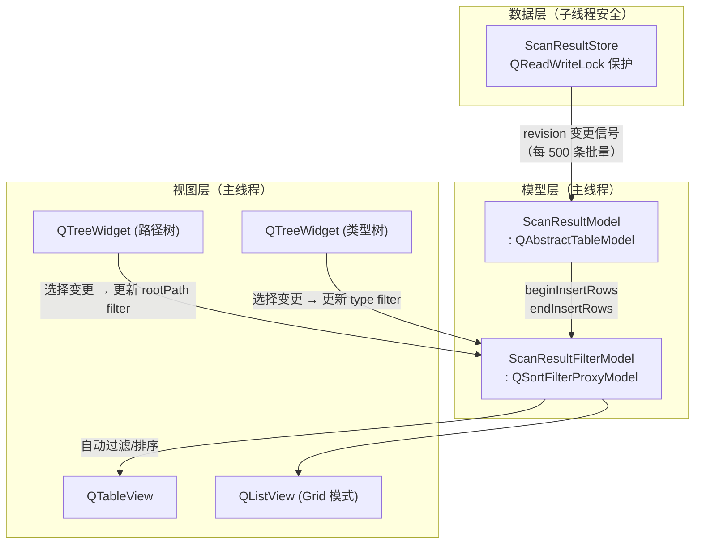

# 大结果集 UI 优化详细设计

> 文档版本：1.0  
> 最后更新：2026-05-26  
> 对应源码：`pages/RecoveryScanPage.h`、`controllers/ScanResultStore.h`、`controllers/ScanTypes.h`

---

## 1. 问题分析

### 1.1 当前架构

`RecoveryScanPage` 使用 `QTableWidget`（项控件模式）展示扫描结果：

```
RecoveryScanController (子线程)
    │  scanIndexUpdated(revision)
    ▼
RecoveryScanPage::onScanIndexUpdated()
    │  从 ScanResultStore 读取新增文件
    │  逐条调用 appendTableRow() / appendGridRow()
    ▼
QTableWidget::setItem(row, col, new QTableWidgetItem(...))
    │  每行 6-8 个 QTableWidgetItem 实例
    │  每行含自定义 CheckBox Widget
    ▼
内存中维护完整 QTableWidgetItem 树
```

### 1.2 性能瓶颈

| 瓶颈点 | 原因 | 影响 |
|--------|------|------|
| **QTableWidgetItem 实例爆炸** | 每行 ~8 个 `QTableWidgetItem`，10 万行 = 80 万对象 | 内存占用 > 1 GB |
| **逐行插入阻塞 UI** | `appendTableRow()` 在主线程逐条执行 `setItem()` | 插入 1 万行耗时 > 2 秒 |
| **全量重绘** | `QTableWidget` 内部维护完整项模型，任何变更触发全表布局计算 | 滚动卡顿 |
| **CheckBox Widget 开销** | 每行嵌入独立 `QCheckBox` + `QWidget` 容器 | 额外布局开销 |
| **搜索全表遍历** | `matchesSearch()` 遍历 `visibleResults_` 全量列表 | 搜索响应 > 1 秒 |
| **缩略图同步解码** | `scheduleGridThumbnail()` 在可见区域变化时频繁触发 | 滚动时帧率下降 |

### 1.3 实测数据（基于现有代码推算）

| 文件数量 | 预计内存 | 插入耗时 | 滚动帧率 |
|----------|----------|----------|----------|
| 1,000 | ~50 MB | <200 ms | 60 fps |
| 10,000 | ~300 MB | ~2 s | 30-45 fps |
| 50,000 | ~800 MB | ~12 s | 10-20 fps |
| 100,000 | >1.5 GB | >25 s | <10 fps |

---

## 2. 方案设计

### 2.1 整体架构



### 2.2 ScanResultModel 类设计

```cpp
// models/ScanResultModel.h
#pragma once

#include <QAbstractTableModel>
#include <QVector>
#include "../controllers/ScanTypes.h"

class ScanResultStore;

class ScanResultModel : public QAbstractTableModel
{
    Q_OBJECT

public:
    enum Column {
        ColCheckBox = 0,
        ColName,
        ColSize,
        ColType,
        ColModified,
        ColPath,
        ColRecoverability,
        ColCount
    };

    enum Role {
        FileIdRole = Qt::UserRole + 1,
        IsDirectoryRole,
        RelativePathRole,
        ExtensionRole,
        SizeBytesRole,
        ModifyTimeFtRole,
        PreviewKindRole,
    };

    explicit ScanResultModel(QObject *parent = nullptr);

    // ── QAbstractTableModel 必须实现 ──
    int rowCount(const QModelIndex &parent = QModelIndex()) const override;
    int columnCount(const QModelIndex &parent = QModelIndex()) const override;
    QVariant data(const QModelIndex &index,
                  int role = Qt::DisplayRole) const override;
    QVariant headerData(int section, Qt::Orientation orientation,
                        int role = Qt::DisplayRole) const override;
    Qt::ItemFlags flags(const QModelIndex &index) const override;

    // ── CheckBox 支持 ──
    bool setData(const QModelIndex &index, const QVariant &value,
                 int role = Qt::EditRole) override;

    // ── 批量数据接入 ──
    void setResultStore(ScanResultStore *store);
    void clear();

public slots:
    void onStoreRevisionChanged(quint64 revision);

signals:
    void checkedIdsChanged();

private:
    void appendBatch(const QVector<ScanFileDto> &batch);

    ScanResultStore *store_ = nullptr;
    QVector<ScanFileDto> rows_;
    QSet<quint64> checkedIds_;
    quint64 lastSyncRevision_ = 0;
};
```

**关键实现细节：**

#### rowCount / columnCount

```cpp
int ScanResultModel::rowCount(const QModelIndex &parent) const
{
    return parent.isValid() ? 0 : rows_.size();
}

int ScanResultModel::columnCount(const QModelIndex &parent) const
{
    return parent.isValid() ? 0 : ColCount;
}
```

#### data() — 按列返回

```cpp
QVariant ScanResultModel::data(const QModelIndex &index, int role) const
{
    if (!index.isValid() || index.row() >= rows_.size())
        return {};

    const auto &dto = rows_.at(index.row());

    if (role == Qt::CheckStateRole && index.column() == ColCheckBox)
        return checkedIds_.contains(dto.id) ? Qt::Checked : Qt::Unchecked;

    if (role == Qt::DisplayRole) {
        switch (index.column()) {
        case ColName:          return dto.name;
        case ColSize:          return formatSize(dto.sizeBytes);
        case ColType:          return dto.extension.toUpper();
        case ColModified:      return formatFileTime(dto.modifyTimeFt);
        case ColPath:          return dto.relativePath;
        case ColRecoverability:return dto.isDeleted
                                      ? tr("已删除") : tr("正常");
        default:               return {};
        }
    }

    if (role == FileIdRole)        return QVariant::fromValue(dto.id);
    if (role == IsDirectoryRole)   return dto.isDirectory;
    if (role == RelativePathRole)  return dto.relativePath;
    if (role == ExtensionRole)     return dto.extension;
    if (role == SizeBytesRole)     return QVariant::fromValue(dto.sizeBytes);
    if (role == ModifyTimeFtRole)  return QVariant::fromValue(dto.modifyTimeFt);

    return {};
}
```

#### 批量 append

```cpp
void ScanResultModel::appendBatch(const QVector<ScanFileDto> &batch)
{
    if (batch.isEmpty()) return;

    const int first = rows_.size();
    const int last  = first + batch.size() - 1;

    beginInsertRows(QModelIndex(), first, last);
    rows_.append(batch);
    endInsertRows();
}
```

#### 从 ScanResultStore 同步

```cpp
void ScanResultModel::onStoreRevisionChanged(quint64 revision)
{
    if (!store_ || revision <= lastSyncRevision_)
        return;

    // ScanResultStore 线程安全，可在主线程读取
    const int storeCount = store_->fileCount();
    const int localCount = rows_.size();

    if (storeCount <= localCount) {
        lastSyncRevision_ = revision;
        return;
    }

    // 收集新增的 DTO（通过 id 遍历，ScanResultStore 保证 id 递增）
    QVector<ScanFileDto> batch;
    batch.reserve(storeCount - localCount);

    // 使用 Store 提供的增量查询接口
    // ... 从 store_ 读取 [localCount, storeCount) 范围的新文件 ...

    appendBatch(batch);
    lastSyncRevision_ = revision;
}
```

### 2.3 headerData

```cpp
QVariant ScanResultModel::headerData(int section, Qt::Orientation orientation,
                                      int role) const
{
    if (orientation != Qt::Horizontal || role != Qt::DisplayRole)
        return {};
    switch (section) {
    case ColCheckBox:      return {};  // 全选 CheckBox 通过自定义 HeaderView 实现
    case ColName:          return tr("文件名");
    case ColSize:          return tr("大小");
    case ColType:          return tr("类型");
    case ColModified:      return tr("修改时间");
    case ColPath:          return tr("路径");
    case ColRecoverability:return tr("状态");
    default:               return {};
    }
}
```

---

## 3. 搜索/筛选方案

### 3.1 ScanResultFilterModel 设计

```cpp
// models/ScanResultFilterModel.h
#pragma once

#include <QSortFilterProxyModel>
#include <QDateTime>

class ScanResultFilterModel : public QSortFilterProxyModel
{
    Q_OBJECT

public:
    explicit ScanResultFilterModel(QObject *parent = nullptr);

    // ── 筛选条件设置 ──
    void setNameFilter(const QString &keyword);
    void setExtensionFilter(const QStringList &extensions);
    void setSizeRange(qint64 minBytes, qint64 maxBytes);
    void setDateRange(const QDateTime &from, const QDateTime &to);
    void setRecoverabilityFilter(int minLevel);
    void setPathPrefix(const QString &relPath);
    void setTypeCategory(const QString &category);
    void clearAllFilters();

protected:
    bool filterAcceptsRow(int sourceRow,
                          const QModelIndex &sourceParent) const override;
    bool lessThan(const QModelIndex &left,
                  const QModelIndex &right) const override;

private:
    QString nameKeyword_;
    QStringList extensionFilter_;
    qint64 minSize_ = -1;
    qint64 maxSize_ = -1;
    QDateTime dateFrom_;
    QDateTime dateTo_;
    int minRecoverability_ = -1;
    QString pathPrefix_;
    QString typeCategory_;
};
```

### 3.2 filterAcceptsRow 实现

```cpp
bool ScanResultFilterModel::filterAcceptsRow(int sourceRow,
                                              const QModelIndex &parent) const
{
    auto idx = [&](int col) {
        return sourceModel()->index(sourceRow, col, parent);
    };

    // 文件名关键字
    if (!nameKeyword_.isEmpty()) {
        const QString name = idx(ScanResultModel::ColName)
                                 .data(Qt::DisplayRole).toString();
        if (!name.contains(nameKeyword_, Qt::CaseInsensitive))
            return false;
    }

    // 扩展名
    if (!extensionFilter_.isEmpty()) {
        const QString ext = idx(ScanResultModel::ColName)
                                .data(ScanResultModel::ExtensionRole).toString();
        if (!extensionFilter_.contains(ext, Qt::CaseInsensitive))
            return false;
    }

    // 大小范围
    if (minSize_ >= 0 || maxSize_ >= 0) {
        const qint64 size = idx(ScanResultModel::ColSize)
                                .data(ScanResultModel::SizeBytesRole).toLongLong();
        if (minSize_ >= 0 && size < minSize_) return false;
        if (maxSize_ >= 0 && size > maxSize_) return false;
    }

    // 日期范围
    if (dateFrom_.isValid() || dateTo_.isValid()) {
        const quint64 ft = idx(ScanResultModel::ColModified)
                               .data(ScanResultModel::ModifyTimeFtRole)
                               .toULongLong();
        // Windows FILETIME → QDateTime 转换
        // ...
    }

    // 路径前缀
    if (!pathPrefix_.isEmpty()) {
        const QString path = idx(ScanResultModel::ColPath)
                                 .data(ScanResultModel::RelativePathRole).toString();
        if (!path.startsWith(pathPrefix_, Qt::CaseInsensitive))
            return false;
    }

    return true;
}
```

### 3.3 排序支持

```cpp
bool ScanResultFilterModel::lessThan(const QModelIndex &left,
                                      const QModelIndex &right) const
{
    const int col = left.column();

    switch (col) {
    case ScanResultModel::ColSize: {
        const qint64 l = left.data(ScanResultModel::SizeBytesRole).toLongLong();
        const qint64 r = right.data(ScanResultModel::SizeBytesRole).toLongLong();
        return l < r;
    }
    case ScanResultModel::ColModified: {
        const quint64 l = left.data(ScanResultModel::ModifyTimeFtRole).toULongLong();
        const quint64 r = right.data(ScanResultModel::ModifyTimeFtRole).toULongLong();
        return l < r;
    }
    default:
        return QSortFilterProxyModel::lessThan(left, right);
    }
}
```

### 3.4 搜索延迟触发（Debounce）

```cpp
// 在 RecoveryScanPage 中集成
void RecoveryScanPage::setupSearch()
{
    searchTimer_ = new QTimer(this);
    searchTimer_->setSingleShot(true);
    searchTimer_->setInterval(300);  // 300ms debounce

    connect(searchEdit_, &QLineEdit::textChanged,
            this, [this](const QString &text) {
        pendingSearchText_ = text;
        searchTimer_->start();
    });

    connect(searchTimer_, &QTimer::timeout,
            this, [this]() {
        filterModel_->setNameFilter(pendingSearchText_);
    });
}
```

**交互流程：**

```
用户输入 "photo" (逐字母)
  t=0ms    "p"     → 启动 300ms 定时器
  t=100ms  "ph"    → 重启 300ms 定时器
  t=200ms  "pho"   → 重启 300ms 定时器
  t=280ms  "phot"  → 重启 300ms 定时器
  t=350ms  "photo" → 重启 300ms 定时器
  t=650ms  定时器触发 → filterModel_->setNameFilter("photo")
                     → QSortFilterProxyModel::invalidateFilter()
                     → QTableView 自动刷新可见行
```

---

## 4. 虚拟化策略

### 4.1 QTableView 惰性渲染

`QTableView` 基于 Model/View 架构，**天然支持虚拟化**：

- 只为可见行调用 `data()`，不创建 QWidget 实例
- 滚动时仅重新查询可见区域的数据，不重建整个列表
- `QStyledItemDelegate` 直接绘制到 QPainter，无 Widget 开销

```
┌──────────────────────────────┐
│ QTableView 可见区域           │
│  ┌────────────────────────┐  │
│  │ Row 1000 ← data()     │  │ ← 只有这些行被查询
│  │ Row 1001 ← data()     │  │
│  │ ...                    │  │
│  │ Row 1025 ← data()     │  │
│  └────────────────────────┘  │
│                              │
│  Row 0..999     ← 不查询     │
│  Row 1026..N    ← 不查询     │
└──────────────────────────────┘
```

### 4.2 数据端分批通知

`ScanResultStore` 与 `ScanResultModel` 之间采用分批同步策略：

```cpp
// RecoveryScanController 中的分批信号
void RecoveryScanWorker::onFileFound(const FileNode &node)
{
    pendingBatch_.append(convertToDto(node));

    if (pendingBatch_.size() >= 500) {   // 每 500 条发一次
        emit fileBatchReady(pendingBatch_);
        pendingBatch_.clear();
    }
}

// 扫描结束时刷出剩余
void RecoveryScanWorker::onScanDone()
{
    if (!pendingBatch_.isEmpty()) {
        emit fileBatchReady(pendingBatch_);
        pendingBatch_.clear();
    }
}
```

**ScanResultModel 端的处理：**

```
信号: scanIndexUpdated(revision)
  │
  ▼
ScanResultModel::onStoreRevisionChanged(revision)
  │  计算增量: newCount = store_->fileCount() - rows_.size()
  │
  ├─ newCount < 500  → 累积等待下次通知
  │
  └─ newCount >= 500 → 立即 appendBatch()
                        beginInsertRows(first, last)
                        rows_.append(batch)
                        endInsertRows()
                        │
                        ▼
                    QTableView 仅刷新可见行（如果可见行在新增范围内）
```

### 4.3 内存优化：FileNode 按需加载

`ScanFileDto` 是轻量描述对象（约 200 字节/条），10 万条约 20 MB，可全部常驻内存。

重型数据（预览缩略图、完整文件簇列表）按需从 `ScanResultStore` 加载：

```
┌─────────────────────────────────────┐
│          ScanResultModel            │
│                                     │
│  rows_: QVector<ScanFileDto>        │  ← 20 MB @ 100K rows
│  checkedIds_: QSet<quint64>         │  ← ~1 MB
│                                     │
│  总计: ~21 MB                        │
└────────────┬────────────────────────┘
             │ 按需查询
             ▼
┌─────────────────────────────────────┐
│         ScanResultStore             │
│                                     │
│  files_: QHash<id, ScanFileDto>     │  ← 索引数据
│  previewResidentBlobs_              │  ← 仅已请求的缩略图
│  previewFileNodes_                  │  ← 仅已请求的完整节点
│  recoveredFileNodes_                │  ← 仅已恢复的文件
│                                     │
│  路径索引 / 类型索引                  │  ← 按需构建
└─────────────────────────────────────┘
```

### 4.4 缩略图虚拟化

Grid 视图中的缩略图采用异步加载 + LRU 缓存策略：

```cpp
class ThumbnailCache
{
public:
    QPixmap get(quint64 fileId) const;
    void put(quint64 fileId, const QPixmap &pixmap);
    void setCapacity(int maxEntries);  // 默认 500

private:
    QHash<quint64, QPixmap> cache_;
    QList<quint64> lruOrder_;
    int capacity_ = 500;
};
```

**加载流程：**

```
QTableView/QListView 可见区域变化
    │
    ▼
Delegate::paint(painter, option, index)
    │
    ├─ ThumbnailCache::get(fileId) → 命中 → 直接绘制
    │
    └─ 未命中 → 绘制占位图 + 提交异步加载请求
                    │
                    ▼
            ThumbnailLoader (QThreadPool)
                    │  读取文件数据
                    │  解码缩略图
                    ▼
            信号: thumbnailReady(fileId, pixmap)
                    │
                    ▼
            ThumbnailCache::put(fileId, pixmap)
            Model::dataChanged(index, index)  ← 触发重绘该行
```

---

## 5. 性能目标

### 5.1 量化指标

| 指标 | 目标值 | 测量方法 |
|------|--------|----------|
| 10 万条记录滚动帧率 | ≥ 60 fps | QElapsedTimer 测量 paint 耗时 |
| 搜索响应时间 | < 200 ms | 从 `invalidateFilter()` 到 `layoutChanged` |
| 插入 500 条批次耗时 | < 5 ms | `beginInsertRows` 到 `endInsertRows` |
| 内存占用（10 万条） | < 500 MB | Windows 任务管理器 / Valgrind |
| 启动到可交互时间 | < 2 秒 | 加载 10 万条快照到第一次滚动 |

### 5.2 内存预算

| 组件 | 10 万条预算 | 说明 |
|------|-------------|------|
| `ScanFileDto` 数组 | ~20 MB | 每条 ~200 B |
| `ScanResultStore` 索引 | ~30 MB | 路径/类型索引 Hash |
| `QSortFilterProxyModel` | ~4 MB | 排序/过滤映射表 |
| 缩略图缓存 | ~50 MB | 500 张 × ~100 KB |
| 路径树/类型树 | ~10 MB | QTreeWidgetItem 实例 |
| Qt 框架基础 | ~50 MB | — |
| **总计** | **~164 MB** | 远低于 500 MB 预算 |

### 5.3 性能基准测试方案

```cpp
// tests/bench_scan_result_model.cpp
void benchmarkInsert100k()
{
    ScanResultModel model;
    QVector<ScanFileDto> batch;
    batch.reserve(500);

    QElapsedTimer timer;
    timer.start();

    for (int i = 0; i < 100000; ++i) {
        ScanFileDto dto;
        dto.id = i;
        dto.name = QString("file_%1.jpg").arg(i);
        dto.sizeBytes = 1024 * (i % 1000);
        dto.relativePath = QString("dir%1/").arg(i / 100);
        batch.append(dto);

        if (batch.size() >= 500) {
            model.onStoreRevisionChanged(i);  // 触发批量插入
            batch.clear();
        }
    }

    qDebug() << "Insert 100K rows:" << timer.elapsed() << "ms";
    // 目标: < 500 ms
}

void benchmarkFilter100k()
{
    // ... 准备 10 万条数据的 model ...
    ScanResultFilterModel filter;
    filter.setSourceModel(&model);

    QElapsedTimer timer;
    timer.start();

    filter.setNameFilter("photo");

    qDebug() << "Filter 100K rows:" << timer.elapsed() << "ms";
    // 目标: < 200 ms
}
```

---

## 6. 迁移路径

### 6.1 分阶段迁移方案

```
阶段 1：引入 Model（非破坏性并存）
├── 创建 ScanResultModel 和 ScanResultFilterModel
├── 在 RecoveryScanPage 中添加 QTableView（隐藏）
├── 同时向 QTableWidget 和 ScanResultModel 填充数据
├── 验证数据一致性
└── 预计工时: 3 天

阶段 2：切换主视图
├── 将 QTableView 替换 QTableWidget 为主结果视图
├── 实现自定义 Delegate（CheckBox 绘制、图标渲染）
├── 连接路径树/类型树的选择 → FilterModel 的路径/类型筛选
├── 验证功能完整性
└── 预计工时: 5 天

阶段 3：搜索/筛选增强
├── 实现 ScanResultFilterModel 的全部筛选条件
├── 添加搜索 debounce
├── 添加高级筛选 UI（大小范围、日期范围、可恢复性）
└── 预计工时: 3 天

阶段 4：Grid 视图迁移
├── 将 QListWidget Grid 替换为 QListView + QStyledItemDelegate
├── 实现 ThumbnailCache + 异步加载
├── 验证缩略图加载性能
└── 预计工时: 4 天

阶段 5：删除旧代码
├── 移除 QTableWidget 和 QListWidget 相关代码
├── 移除 RecoveryScanPage 中的冗余成员变量
├── 性能基准测试
└── 预计工时: 2 天
```

### 6.2 保持 CheckBox 勾选功能

**现有实现：** 每行嵌入 `QCheckBox` Widget，通过 `createTableCheckBoxWidget()` 创建。

**迁移方案：** 使用 Model 的 `Qt::CheckStateRole` + 自定义 Delegate 绘制：

```cpp
// CheckBoxDelegate — 替代每行嵌入 QCheckBox Widget
class CheckBoxDelegate : public QStyledItemDelegate
{
    Q_OBJECT
public:
    using QStyledItemDelegate::QStyledItemDelegate;

    void paint(QPainter *painter, const QStyleOptionViewItem &option,
               const QModelIndex &index) const override
    {
        // 绘制 CheckBox 指示器
        QStyleOptionButton checkOpt;
        checkOpt.rect = checkBoxRect(option);
        checkOpt.state = Qt::ItemIsUserCheckable;

        const auto state = index.data(Qt::CheckStateRole).value<Qt::CheckState>();
        if (state == Qt::Checked)
            checkOpt.state |= QStyle::State_On;
        else
            checkOpt.state |= QStyle::State_Off;

        QApplication::style()->drawControl(QStyle::CE_CheckBox,
                                            &checkOpt, painter);
    }

    bool editorEvent(QEvent *event, QAbstractItemModel *model,
                     const QStyleOptionViewItem &option,
                     const QModelIndex &index) override
    {
        if (event->type() == QEvent::MouseButtonRelease) {
            const auto *me = static_cast<QMouseEvent *>(event);
            if (checkBoxRect(option).contains(me->pos())) {
                auto state = index.data(Qt::CheckStateRole).value<Qt::CheckState>();
                state = (state == Qt::Checked) ? Qt::Unchecked : Qt::Checked;
                model->setData(index, state, Qt::CheckStateRole);
                return true;
            }
        }
        return QStyledItemDelegate::editorEvent(event, model, option, index);
    }

private:
    QRect checkBoxRect(const QStyleOptionViewItem &option) const
    {
        QStyleOptionButton checkOpt;
        QRect r = QApplication::style()->subElementRect(
            QStyle::SE_CheckBoxIndicator, &checkOpt);
        r.moveCenter(QPoint(option.rect.left() + 20,
                            option.rect.center().y()));
        return r;
    }
};
```

**与树视图的联动保持：**

```
用户在路径树中勾选文件夹 "Documents/"
    │
    ▼
RecoveryScanPage::onPathTreeItemChanged()
    │  遍历 ScanResultStore::pathDirectChildIds("Documents/")
    │  批量更新 ScanResultModel::checkedIds_
    ▼
ScanResultModel::setData(index, Qt::Checked, Qt::CheckStateRole)
    │  emit dataChanged(topLeft, bottomRight, {Qt::CheckStateRole})
    ▼
QTableView 只重绘可见行的 CheckBox 列
```

### 6.3 保持路径树/类型树视图

路径树和类型树继续使用 `QTreeWidget`（数据量通常在数千级别，性能可接受），但将其与 `ScanResultFilterModel` 联动：

```cpp
void RecoveryScanPage::onPathTreeCurrentChanged(QTreeWidgetItem *current)
{
    if (!current) return;

    const QString relPath = current->data(0, Qt::UserRole).toString();
    filterModel_->setPathPrefix(relPath);
    // QSortFilterProxyModel 自动重新过滤
    // QTableView 自动只显示匹配行
}

void RecoveryScanPage::onTypeTreeCurrentChanged(QTreeWidgetItem *current)
{
    if (!current) return;

    const QString category = current->data(0, Qt::UserRole).toString();
    filterModel_->setTypeCategory(category);
}
```

### 6.4 需要移除的旧成员变量

以下 `RecoveryScanPage` 成员在迁移完成后可移除：

```cpp
// 由 ScanResultModel 替代
QHash<quint64, ScanFileDto> files_;                    // → Model 内部 rows_
QList<ScanFileDto> visibleResults_;                     // → FilterModel 管理
QVector<quint64> visibleTypeCandidateIds_;              // → FilterModel 管理
int visibleTypeCandidateCursor_;                        // → 不再需要
bool visibleResultsUseTypePaging_;                      // → 不再需要
bool visibleResultsContinuationScheduled_;              // → 不再需要
quint64 visibleResultsGeneration_;                      // → 不再需要
Qt::CheckState visibleResultsDefaultState_;             // → Model 管理
int visibleResultsLoaded_;                              // → 不再需要

// 由 FilterModel 替代
QHash<QString, QStringList> pathChildDirectories_;      // → Store 直接查询
QHash<QString, int> pathNodeCounts_;                    // → Store 直接查询
QHash<QString, QVector<quint64>> pathDirectChildIds_;   // → Store 直接查询
QHash<QString, QStringList> typeCategoryChildren_;      // → Store 直接查询
QHash<QString, int> typeNodeCounts_;                    // → Store 直接查询
QHash<QString, QVector<quint64>> typeNodeFileIds_;      // → Store 直接查询

// 由 QTableView 替代
QTableWidget *table_;                                   // → QTableView *tableView_
QListWidget *gridView_;                                 // → QListView *gridView_
```

### 6.5 兼容性检查清单

| 功能 | 现有实现 | 迁移后实现 | 验证方法 |
|------|----------|-----------|----------|
| 文件列表显示 | `QTableWidget::setItem()` | `ScanResultModel::data()` | 视觉对比 |
| CheckBox 勾选 | 嵌入 `QCheckBox` Widget | `Qt::CheckStateRole` + Delegate | 勾选/取消功能测试 |
| 全选 | `headerSelectAllCheckBox_` | 自定义 `QHeaderView` section | 全选/取消功能测试 |
| 路径树联动 | `refillTableFromPathItem()` | `FilterModel::setPathPrefix()` | 点击树节点验证表格过滤 |
| 类型树联动 | `refillTableFromTypeItem()` | `FilterModel::setTypeCategory()` | 点击树节点验证表格过滤 |
| 搜索高亮 | `matchesSearch()` + 手动过滤 | `FilterModel::setNameFilter()` | 输入关键字验证 |
| 排序 | 无 | `QSortFilterProxyModel::sort()` | 点击表头验证排序 |
| Grid 缩略图 | `QListWidget` + `createGridCard()` | `QListView` + `ThumbnailDelegate` | 切换视图验证 |
| 恢复选中文件 | `checkedRecoverableIdsFromTable()` | `ScanResultModel::checkedIds()` | 执行恢复验证 |
| 导出报告 | `exportRecoveryDetailReport()` | 保持不变（数据源从 Model 获取） | 导出并打开验证 |
