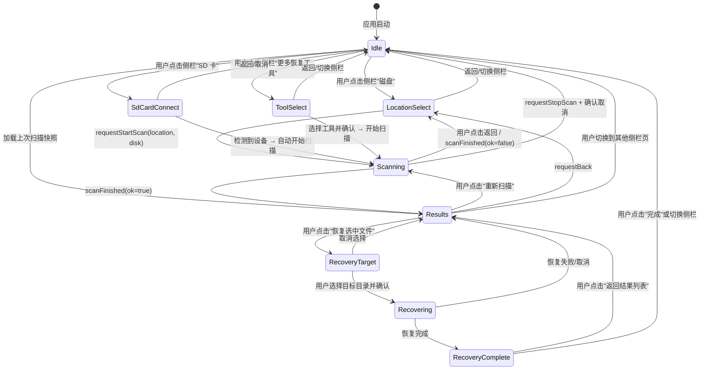
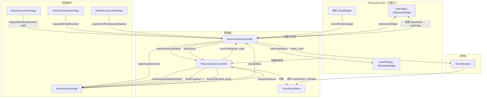
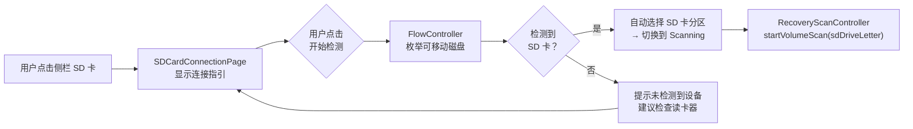
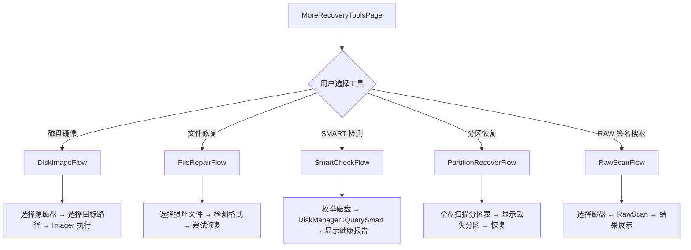

# 恢复流程控制器详细设计

> 文档版本：1.0  
> 最后更新：2026-05-26  
> 对应源码：`controllers/RecoveryFlowController.h/.cpp`、`PhoenixRecover.h/.cpp`

---

## 1. 概述

`RecoveryFlowController` 是 PhoenixRecover 应用的**页面路由与流程状态管理中枢**。它的职责包括：

| 职责 | 说明 |
|------|------|
| 页面路由 | 管理 `QStackedWidget` 中的页面切换顺序（位置选择 → 扫描 → 结果 → 恢复目标选择 → 完成） |
| 流程状态机 | 维护一个有限状态机（FSM），确保每个阶段只接受合法的转换操作 |
| 控制器协调 | 连接 `RecoveryScanController`、各 Page 的信号，将用户意图转为扫描/恢复动作 |
| 会话管理 | 通过 `ScanSerializer` 实现扫描结果的保存与恢复 |
| 子流程集成 | 统一管理 SD 卡恢复、磁盘镜像、文件修复、SMART 等扩展流程的入口 |

### 1.1 现状分析

当前 `RecoveryFlowController` 仅有三个占位 slot（`handleLocationRequested`、`handleSdCardRecoveryRequested`、`handleToolRecoveryRequested`），通过 `QMessageBox::information` 弹出提示，**尚未实现真正的页面路由和状态管理**。页面切换逻辑分散在 `PhoenixRecover.cpp` 构造函数中，以 lambda 和直连形式硬编码，不利于扩展。

### 1.2 设计目标

- 将所有页面路由和流程逻辑收归 `RecoveryFlowController`
- `PhoenixRecover`（主窗口）只负责 UI 组件的创建与布局，不含业务逻辑
- 状态机化管理，避免状态不一致
- 可序列化的会话状态，支持断点续扫

---

## 2. 页面路由状态机

### 2.1 状态定义

```cpp
enum class FlowState {
    Idle,              // 应用启动，尚未选择任何操作
    LocationSelect,    // 用户在选择扫描位置（磁盘/回收站/桌面/文件夹）
    SdCardConnect,     // SD 卡连接与设备检测中
    ToolSelect,        // 更多恢复工具选择界面
    Scanning,          // 正在执行扫描
    Results,           // 扫描完成，展示结果
    RecoveryTarget,    // 用户选择恢复目标路径
    Recovering,        // 正在恢复文件
    RecoveryComplete,  // 恢复完成，展示结果摘要
};
```

### 2.2 状态转换图



### 2.3 转换条件明细

| 起始状态 | 目标状态 | 触发条件 | 守卫条件 |
|----------|----------|----------|----------|
| `Idle` | `LocationSelect` | 侧栏选中"磁盘" | — |
| `Idle` | `SdCardConnect` | 侧栏选中"SD 卡" | — |
| `Idle` | `ToolSelect` | 侧栏选中"更多恢复工具" | — |
| `Idle` | `Results` | 检测到上次未保存的扫描快照 | `.prs` 文件有效 |
| `LocationSelect` | `Scanning` | `RecoveryLocationPage::requestStartScan` | diskLetter 非空 |
| `SdCardConnect` | `Scanning` | 设备枚举成功 | 检测到可移动介质 |
| `Scanning` | `Results` | `RecoveryScanController::scanFinished(true)` | — |
| `Scanning` | 前一状态 | `RecoveryScanPage::requestBack` | 停止扫描后回退 |
| `Results` | `RecoveryTarget` | 用户勾选文件并点击恢复 | 至少勾选 1 个文件 |
| `RecoveryTarget` | `Recovering` | 用户确认目标目录 | 目标路径非源分区 |
| `Recovering` | `RecoveryComplete` | 恢复引擎完成回调 | — |

### 2.4 返回/取消处理策略

```
返回键行为规则：
1. Scanning → 弹出确认对话框（"扫描正在进行，确认放弃？"）
   - 确认 → stopScan() → 回退到 LocationSelect/SdCardConnect
   - 取消 → 留在 Scanning
2. Results → 直接回退到 LocationSelect（扫描数据保留在内存）
3. RecoveryTarget → 直接回退到 Results
4. Recovering → 不可返回（进度条模态）
5. RecoveryComplete → 回退到 Results
```

---

## 3. 信号连接架构

### 3.1 控制器连接图



### 3.2 信号连接表

| 信号源 | 信号 | 接收方 | 槽函数 |
|--------|------|--------|--------|
| `RecoveryLocationPage` | `requestStartScan(location, disk)` | `RecoveryFlowController` | `onStartScanRequested()` |
| `SDCardConnectionPage` | `requestSdCardRecovery()` | `RecoveryFlowController` | `onSdCardRecoveryRequested()` |
| `MoreRecoveryToolsPage` | `requestToolRecovery(toolName)` | `RecoveryFlowController` | `onToolRecoveryRequested()` |
| `RecoveryScanPage` | `requestBack()` | `RecoveryFlowController` | `onScanPageBack()` |
| `RecoveryScanPage` | `requestStopScan()` | `RecoveryScanController` | `stopScan()` |
| `RecoveryScanController` | `scanFinished(ok, msg)` | `RecoveryFlowController` | `onScanFinished()` |
| `RecoveryScanController` | `scanIndexUpdated(rev)` | `RecoveryScanPage` | `onScanIndexUpdated()` |
| `RecoveryScanController` | `scanProgress(...)` | `RecoveryScanPage` | `setScanProgress()` |
| `QListWidget (sidebar)` | `currentRowChanged(row)` | `RecoveryFlowController` | `onSidebarChanged()` |

---

## 4. 会话保存/恢复机制

### 4.1 现有 ScanSerializer 能力

`ScanSerializer` 已实现 `.prs` 二进制格式的完整序列化，支持：
- `Save(filePath, ScanResult, Partition)` — 保存完整扫描结果
- `Load(filePath, outResult, outPartition)` — 加载扫描快照
- `SuggestFilename(Partition)` — 自动生成文件名（如 `C_NTFS_20260318_143022.prs`）

### 4.2 FlowController 集成方案

```
┌─────────────────────────────────────────────────┐
│                扫描完成后自动保存                  │
├─────────────────────────────────────────────────┤
│ 1. scanFinished(ok=true) 触发                    │
│ 2. FlowController 调用 ScanSerializer::Save()    │
│    目标路径: %APPDATA%/PhoenixRecover/sessions/  │
│    文件名: ScanSerializer::SuggestFilename()     │
│ 3. 将会话路径记入 QSettings（last_session_path）  │
└─────────────────────────────────────────────────┘

┌─────────────────────────────────────────────────┐
│                应用关闭时提示保存                  │
├─────────────────────────────────────────────────┤
│ 1. QMainWindow::closeEvent 中检查当前状态         │
│ 2. 若 state == Scanning → 弹出"是否停止扫描？"    │
│ 3. 若 state == Results && 有未保存修改 →           │
│    弹出"是否保存扫描结果？"                        │
│ 4. 用户选择"保存" → ScanSerializer::Save()        │
│ 5. 用户选择"不保存" → 直接退出                     │
└─────────────────────────────────────────────────┘

┌─────────────────────────────────────────────────┐
│              下次启动时加载上次扫描                │
├─────────────────────────────────────────────────┤
│ 1. FlowController 构造时检查 QSettings            │
│ 2. 若 last_session_path 有效 → 弹出提示：          │
│    "检测到上次扫描结果，是否加载？"                 │
│ 3. 用户选择"加载" →                               │
│    a. ScanSerializer::Load() → ScanResult        │
│    b. 将 FileNode 批量转为 ScanFileDto            │
│    c. 填充 ScanResultStore                       │
│    d. 切换到 Results 状态                         │
│ 4. 用户选择"忽略" → 删除会话文件，进入 Idle       │
└─────────────────────────────────────────────────┘
```

### 4.3 会话文件生命周期

```
创建 → 扫描完成时自动保存 / 用户手动触发"保存结果"
更新 → 用户执行恢复操作后更新恢复状态标记
删除 → 用户启动新扫描时清理旧会话 / 用户手动删除
保留 → 最近 5 个会话文件，超出后 LRU 淘汰
```

---

## 5. SD 卡页和更多工具页的集成

### 5.1 SD 卡恢复流程



**关键实现细节：**

| 步骤 | 实现 |
|------|------|
| 设备枚举 | `DiskManager::GetDisks()` 过滤 `isRemovable == true` |
| 自动扫描 | 若仅一个可移动分区 → 直接启动；多分区 → 弹出选择对话框 |
| 信号路径 | `SDCardConnectionPage::requestSdCardRecovery()` → `FlowController::onSdCardRecoveryRequested()` |

### 5.2 更多恢复工具路由



**工具信号映射：**

| toolName | 目标子流程 | 所需新页面 |
|----------|-----------|-----------|
| `"磁盘镜像"` | `DiskImageFlow` | `DiskImagePage`（选择源/目标） |
| `"文件修复"` | `FileRepairFlow` | 复用文件选择对话框 |
| `"SMART 检测"` | `SmartCheckFlow` | `SmartReportPage`（展示表格） |
| `"分区恢复"` | `PartitionRecoverFlow` | `PartitionScanPage` |
| `"RAW 签名搜索"` | `RawScanFlow` | 复用 `RecoveryScanPage` |

---

## 6. 代码变更清单

### 6.1 RecoveryFlowController.h 变更

```cpp
// 新增枚举
enum class FlowState { /* 见 §2.1 */ };

class RecoveryFlowController : public QObject
{
    Q_OBJECT
public:
    explicit RecoveryFlowController(QWidget *uiParent, QObject *parent = nullptr);

    // ── 新增：初始化连接 ──
    void init(QStackedWidget *outerStack,
              QStackedWidget *wizardPages,
              QWidget *wizardShell,
              RecoveryScanController *scanCtrl,
              RecoveryScanPage *scanPage,
              RecoveryLocationPage *locationPage,
              SDCardConnectionPage *sdPage,
              MoreRecoveryToolsPage *toolsPage);

    // ── 新增：状态查询 ──
    FlowState currentState() const;

    // ── 新增：会话管理 ──
    void tryLoadLastSession();
    void saveCurrentSession();
    bool hasUnsavedSession() const;

public slots:
    // ── 重构原有 slot ──
    void onStartScanRequested(const QString &location, const QString &disk);
    void onSdCardRecoveryRequested();
    void onToolRecoveryRequested(const QString &toolName);

    // ── 新增 slot ──
    void onScanPageBack();
    void onScanFinished(bool ok, const QString &msg);
    void onSidebarChanged(int row);
    void onRecoverRequested(const QVector<quint64> &fileIds);
    void onRecoverTargetSelected(const QString &targetDir);

signals:
    void stateChanged(FlowState newState);

private:
    void setState(FlowState newState);
    void navigateToPage(FlowState target);
    FlowState stateBeforeScanning() const;

    FlowState state_ = FlowState::Idle;
    FlowState prevState_ = FlowState::Idle;  // 用于返回键回退

    QWidget *uiParent_ = nullptr;
    QStackedWidget *outerStack_ = nullptr;
    QStackedWidget *wizardPages_ = nullptr;
    QWidget *wizardShell_ = nullptr;
    RecoveryScanController *scanCtrl_ = nullptr;
    RecoveryScanPage *scanPage_ = nullptr;
    RecoveryLocationPage *locationPage_ = nullptr;
    QString lastSessionPath_;
};
```

### 6.2 RecoveryFlowController.cpp 关键实现

| 方法 | 核心逻辑 |
|------|----------|
| `init()` | 建立所有 `connect()` 连接；检查并提示加载上次会话 |
| `onStartScanRequested()` | 验证 diskLetter → 切换 outerStack → 调用 `scanCtrl_->startVolumeScan()` → `setState(Scanning)` |
| `onScanPageBack()` | 若 `Scanning` → 确认对话框 → `stopScan()` → 回退；若 `Results` → 直接回退 |
| `onScanFinished()` | `setState(Results)` → 自动调用 `saveCurrentSession()` |
| `onSidebarChanged()` | 根据 row 的 UserRole 数据切换 wizardPages 并更新 state |
| `saveCurrentSession()` | 通过 `RecoveryScanController::resultStore()` 提取数据 → `ScanSerializer::Save()` |
| `tryLoadLastSession()` | 读取 QSettings → 验证文件 → 提示用户 → 加载数据 → `setState(Results)` |

### 6.3 PhoenixRecover.cpp 变更

**移除的逻辑（迁移到 FlowController）：**
- `handleStartScanRequest()` 私有方法中的页面切换逻辑
- `connect(scanPage, &RecoveryScanPage::requestBack, ...)` 中的 lambda
- 侧栏 `currentRowChanged` 的 lambda 连接

**新增的逻辑：**
```cpp
PhoenixRecover::PhoenixRecover(QWidget *parent)
    : QMainWindow(parent)
{
    // ... UI 创建代码保持不变 ...

    controller_ = new RecoveryFlowController(this, this);
    scanController_ = new RecoveryScanController(this);

    // 统一初始化信号连接
    controller_->init(outerStack_, wizardPages_, wizardShell_,
                      scanController_, scanPage_,
                      locationPage_, sdPage, toolsPage);
}

void PhoenixRecover::closeEvent(QCloseEvent *event)
{
    if (controller_->hasUnsavedSession()) {
        auto reply = QMessageBox::question(this,
            tr("保存扫描结果"),
            tr("当前有未保存的扫描结果，是否保存？"),
            QMessageBox::Save | QMessageBox::Discard | QMessageBox::Cancel);
        if (reply == QMessageBox::Save) {
            controller_->saveCurrentSession();
        } else if (reply == QMessageBox::Cancel) {
            event->ignore();
            return;
        }
    }
    event->accept();
}
```

### 6.4 变更影响评估

| 文件 | 变更类型 | 影响范围 |
|------|----------|----------|
| `RecoveryFlowController.h` | **大幅重构** | 新增状态机、成员变量、信号/槽 |
| `RecoveryFlowController.cpp` | **大幅重构** | 重写全部方法实现 |
| `PhoenixRecover.h` | 小幅修改 | 新增 `closeEvent` 声明 |
| `PhoenixRecover.cpp` | 中幅修改 | 移除分散的连接逻辑，改为调用 `controller_->init()` |
| `RecoveryScanPage.h` | 无变更 | 信号/槽接口已足够 |
| `RecoveryScanController.h` | 无变更 | 现有接口已满足需求 |
| `CMakeLists.txt` | 无变更 | 无需新增源文件 |
