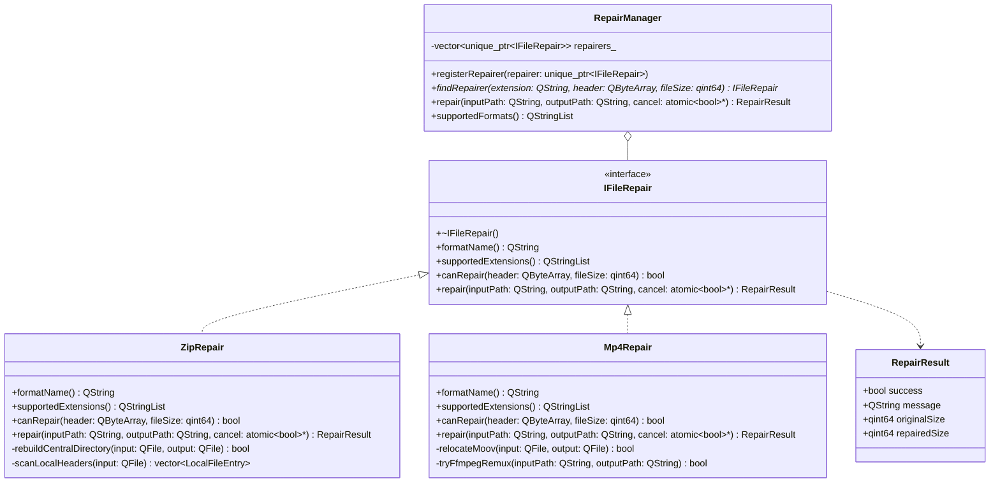
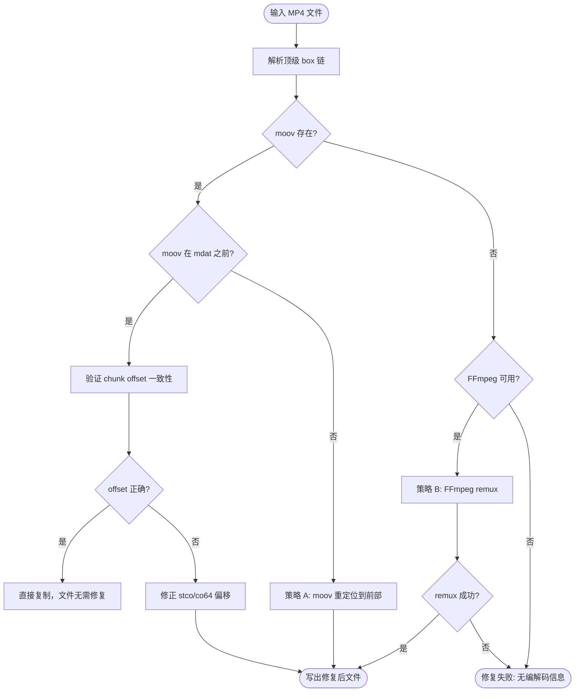

# 修复子系统详细设计

> **文档版本**：v1.0  
> **最后更新**：2026-05-26  
> **模块位置**：`repair/`（待新建）

---

## 1. 概述与目标

### 1.1 背景

数据恢复工具恢复出的文件经常存在不同程度的损坏：

- **ZIP 文件**：EOCD（End of Central Directory）缺失、中心目录损坏、本地文件头与中心目录不一致——常见于恢复自格式化卷或签名雕刻截断的场景。
- **MP4 文件**：moov atom 缺失（录制过程中断）、box 链断裂、mdat 与 moov 偏移不一致——常见于手机/行车记录仪意外断电。

这些损坏模式具有一定的结构规律性，可以通过程序化修复来提升恢复成功率。

### 1.2 目标

- 为部分损坏的常见文件提供**自动修复能力**。
- **v0 版本**覆盖 **ZIP** 和 **MP4** 两种格式。
- **v1 版本**规划 JPEG 和 PNG 修复。
- 提供统一的修复接口 `IFileRepair`，支持后续扩展更多格式。
- 修复过程**非破坏性**——始终保留原始文件，修复结果写入新文件。
- 支持**异步执行**与**取消操作**。

---

## 2. 架构设计

### 2.1 目录结构

```
repair/
├── IFileRepair.h           // 修复接口定义
├── RepairResult.h          // 修复结果结构体
├── RepairManager.h         // 修复器注册/查找/执行
├── RepairManager.cpp
├── ZipRepair.h             // ZIP 修复实现
├── ZipRepair.cpp
├── Mp4Repair.h             // MP4 修复实现
├── Mp4Repair.cpp
├── JpegRepair.h            // JPEG 修复实现（v1）
├── JpegRepair.cpp
├── PngRepair.h             // PNG 修复实现（v1）
└── PngRepair.cpp
```

### 2.2 接口定义



### 2.3 核心接口代码

```cpp
// repair/IFileRepair.h
#pragma once

#include <QString>
#include <QStringList>
#include <QByteArray>
#include <atomic>
#include "RepairResult.h"

class IFileRepair
{
public:
    virtual ~IFileRepair() = default;

    // 格式名称（用于 UI 展示），如 "ZIP" / "MP4"
    virtual QString formatName() const = 0;

    // 支持的文件扩展名列表，如 {"zip", "docx", "xlsx"}
    virtual QStringList supportedExtensions() const = 0;

    // 快速判断是否可以尝试修复（基于头部字节和文件大小）
    virtual bool canRepair(const QByteArray& header,
                           qint64 fileSize) const = 0;

    // 执行修复：读取 inputPath，修复后写入 outputPath
    // cancel: 外部取消标志，可为 nullptr
    virtual RepairResult repair(const QString& inputPath,
                                const QString& outputPath,
                                std::atomic<bool>* cancel) = 0;
};
```

### 2.4 修复结果结构体

```cpp
// repair/RepairResult.h
#pragma once

#include <QString>

struct RepairResult
{
    bool    success       = false;   // 修复是否成功
    QString message;                 // 结果描述（成功/失败原因）
    qint64  originalSize  = 0;       // 原始文件大小
    qint64  repairedSize  = 0;       // 修复后文件大小
};
```

### 2.5 修复管理器

```cpp
// repair/RepairManager.h
#pragma once

#include "IFileRepair.h"
#include <vector>
#include <memory>

class RepairManager
{
public:
    RepairManager();

    // 注册一个修复器（接管所有权）
    void registerRepairer(std::unique_ptr<IFileRepair> repairer);

    // 根据扩展名和头部字节查找合适的修复器
    // 返回 nullptr 表示无法修复
    IFileRepair* findRepairer(const QString& extension,
                              const QByteArray& header,
                              qint64 fileSize) const;

    // 便捷方法：自动查找修复器并执行修复
    RepairResult repair(const QString& inputPath,
                        const QString& outputPath,
                        std::atomic<bool>* cancel = nullptr);

    // 返回所有已注册修复器支持的格式名称列表
    QStringList supportedFormats() const;

private:
    std::vector<std::unique_ptr<IFileRepair>> repairers_;
};
```

#### RepairManager 构造函数：自动注册内置修复器

```cpp
// repair/RepairManager.cpp
RepairManager::RepairManager()
{
    registerRepairer(std::make_unique<ZipRepair>());
    registerRepairer(std::make_unique<Mp4Repair>());
    // v1: registerRepairer(std::make_unique<JpegRepair>());
    // v1: registerRepairer(std::make_unique<PngRepair>());
}
```

---

## 3. ZIP 修复策略

### 3.1 ZIP 结构概览

```
┌───────────────────────────────────────────────────────┐
│  Local File Header 1 + File Data 1                    │
│  Local File Header 2 + File Data 2                    │
│  ...                                                  │
│  Local File Header N + File Data N                    │
├───────────────────────────────────────────────────────┤
│  Central Directory Entry 1                            │
│  Central Directory Entry 2                            │
│  ...                                                  │
│  Central Directory Entry N                            │
├───────────────────────────────────────────────────────┤
│  End of Central Directory Record (EOCD)               │
│    - centralDirOffset                                 │
│    - centralDirSize                                   │
│    - totalEntries                                     │
└───────────────────────────────────────────────────────┘
```

### 3.2 检测场景

| 损坏模式 | 检测方法 | 常见原因 |
|---------|---------|---------|
| **EOCD 缺失** | 文件末尾 64KB 内搜索 `PK\x05\x06` 失败 | 文件被截断（签名雕刻、写入中断） |
| **中心目录损坏** | EOCD 的 `centralDirOffset` 指向位置不含有效 `PK\x01\x02` 条目 | 覆盖写入、坏扇区 |
| **本地头与中心目录不一致** | 中心目录条目的 `localHeaderOffset` 指向位置不含有效 `PK\x03\x04` | 部分覆写 |

### 3.3 修复策略：从本地文件头重建中心目录和 EOCD

```
修复流程:
1. 从文件起始位置扫描所有 Local File Header (PK\x03\x04)
2. 对每个 Local Header:
   a. 读取 fileName, compressedSize, uncompressedSize, method, crc32
   b. 如果 compressedSize == 0 且有 Data Descriptor，从 descriptor 中读取
   c. 计算下一个 Local Header 的偏移
3. 构建 Central Directory Entry 列表
4. 写出: 原始 Local Headers + File Data → 新中心目录 → 新 EOCD
```

#### 修复伪代码

```cpp
RepairResult ZipRepair::repair(const QString& inputPath,
                                const QString& outputPath,
                                std::atomic<bool>* cancel)
{
    RepairResult result;
    QFile input(inputPath);
    if (!input.open(QIODevice::ReadOnly)) {
        result.message = "无法打开输入文件";
        return result;
    }
    result.originalSize = input.size();

    // Step 1: 扫描所有本地文件头
    auto entries = scanLocalHeaders(input);
    if (entries.empty()) {
        result.message = "未找到任何有效的 ZIP 本地文件头";
        return result;
    }

    // Step 2: 复制原始数据 + 重建中心目录
    QFile output(outputPath);
    if (!output.open(QIODevice::WriteOnly)) {
        result.message = "无法创建输出文件";
        return result;
    }

    if (!rebuildCentralDirectory(input, output, entries, cancel)) {
        result.message = "重建中心目录失败";
        return result;
    }

    result.success = true;
    result.repairedSize = output.size();
    result.message = QString("成功修复，包含 %1 个文件条目")
                         .arg(entries.size());
    return result;
}
```

### 3.4 本地文件头扫描

```cpp
struct LocalFileEntry
{
    qint64   localHeaderOffset;   // 本地头在文件中的偏移
    uint16_t versionNeeded;
    uint16_t flags;
    uint16_t method;              // 0=store, 8=deflate
    uint16_t modTime;
    uint16_t modDate;
    uint32_t crc32;
    uint32_t compressedSize;
    uint32_t uncompressedSize;
    QByteArray fileName;
    QByteArray extraField;
    qint64   dataOffset;          // 文件数据起始偏移
    qint64   dataEndOffset;       // 文件数据结束偏移
};

std::vector<LocalFileEntry> ZipRepair::scanLocalHeaders(QFile& input)
{
    std::vector<LocalFileEntry> entries;
    const qint64 fileSize = input.size();
    qint64 pos = 0;

    while (pos + 30 <= fileSize) {
        input.seek(pos);
        QByteArray sig = input.read(4);
        if (sig.size() < 4) break;

        // PK\x03\x04 = Local File Header
        if (sig[0] != 'P' || sig[1] != 'K' ||
            sig[2] != 0x03 || sig[3] != 0x04) {
            ++pos;
            continue;
        }

        LocalFileEntry entry;
        entry.localHeaderOffset = pos;
        // ... 读取各字段 ...

        // 处理 Data Descriptor (flags bit 3)
        if (entry.flags & 0x0008) {
            // compressedSize/crc32 在 data 之后的 descriptor 中
            // 需要搜索下一个 PK\x03\x04 或 PK\x01\x02 来确定边界
        }

        entries.push_back(std::move(entry));
        pos = entry.dataEndOffset;
    }

    return entries;
}
```

### 3.5 限制条件

| 限制 | 原因 |
|------|------|
| **加密 ZIP 不修复** | 无法验证修复后数据的正确性（CRC32 在加密层内） |
| **ZIP64 标记为不支持** | 扩展字段解析复杂，v0 先不支持，在 `canRepair` 中返回 `false` |
| **分卷 ZIP 不修复** | 无法保证所有分卷都存在 |
| **嵌套 ZIP 不递归修复** | 仅修复外层容器结构 |

### 3.6 canRepair 判断逻辑

```cpp
bool ZipRepair::canRepair(const QByteArray& header, qint64 fileSize) const
{
    if (fileSize < 22) return false; // 最小 EOCD 大小

    // 必须以 PK 签名开头
    if (header.size() < 4) return false;
    if (header[0] != 'P' || header[1] != 'K') return false;

    // PK\x03\x04 (Local File Header) 或 PK\x05\x06 (EOCD)
    uint8_t b2 = static_cast<uint8_t>(header[2]);
    uint8_t b3 = static_cast<uint8_t>(header[3]);
    if (b2 == 0x03 && b3 == 0x04) return true;  // 正常 ZIP
    if (b2 == 0x05 && b3 == 0x06) return true;  // 仅 EOCD 的空 ZIP

    // ZIP64 检查：PK\x06\x06 → 暂不支持
    if (b2 == 0x06 && b3 == 0x06) return false;

    return false;
}
```

---

## 4. MP4 修复策略

### 4.1 ISO BMFF (MP4) 结构概览

```
┌────────────────────────────────────────────────────────┐
│  ftyp box (文件类型标识)                                │
├────────────────────────────────────────────────────────┤
│  moov box (元数据容器)                                  │
│    ├── mvhd (影片头)                                    │
│    ├── trak (音频轨道)                                  │
│    │   ├── tkhd (轨道头)                                │
│    │   └── mdia → minf → stbl (采样表)                  │
│    └── trak (视频轨道)                                  │
│        ├── tkhd                                        │
│        └── mdia → minf → stbl                          │
├────────────────────────────────────────────────────────┤
│  mdat box (媒体数据)                                    │
└────────────────────────────────────────────────────────┘
```

### 4.2 检测场景

| 损坏模式 | 检测方法 | 常见原因 |
|---------|---------|---------|
| **moov atom 缺失** | 遍历所有顶级 box，无 `moov` 类型 | 录制中断（断电、存储卡拔出） |
| **moov 在尾部且偏移错误** | `moov` 存在但 `stbl` 中的 chunk offset 与 `mdat` 位置不符 | 录制完成但文件被截断后重新拼接 |
| **box 链断裂** | 顶级 box 的 size 字段为 0 或指向超出文件范围 | 坏扇区、部分覆写 |

### 4.3 修复策略 A：moov 重定位

当 `moov` box 存在于文件尾部，但播放器因 `mdat` 过大而无法定位时：

```
修复前:                          修复后:
┌──────┐                        ┌──────┐
│ ftyp │                        │ ftyp │
├──────┤                        ├──────┤
│ mdat │  ← 很大               │ moov │  ← 移到前面
│      │                        ├──────┤
│      │                        │ mdat │
├──────┤                        │      │
│ moov │  ← 在尾部             │      │
└──────┘                        └──────┘

注意：moov 中的 chunk offset 需要全部加上 moov.size 的偏移量
```

#### 重定位实现要点

```cpp
bool Mp4Repair::relocateMoov(QFile& input, QFile& output)
{
    // 1. 解析所有顶级 box，找到 ftyp、moov、mdat 的位置和大小
    auto boxes = parseTopLevelBoxes(input);

    BoxInfo* ftyp = findBox(boxes, "ftyp");
    BoxInfo* moov = findBox(boxes, "moov");
    BoxInfo* mdat = findBox(boxes, "mdat");

    if (!moov || !mdat) return false;

    // 2. 读取 moov 数据
    QByteArray moovData = readBox(input, *moov);

    // 3. 计算偏移调整量
    //    如果 moov 原在 mdat 之后，现在移到 mdat 之前
    //    则 mdat 中数据的绝对偏移增加了 moov.size
    qint64 offsetDelta = moov->size; // moov 移到前面后 mdat 向后位移

    // 4. 修改 moov 中所有 stco/co64 box 的 chunk offset
    adjustChunkOffsets(moovData, offsetDelta);

    // 5. 写出: ftyp → moov(修改后) → mdat → 其他 box
    if (ftyp) output.write(readBox(input, *ftyp));
    output.write(moovData);
    copyBox(input, output, *mdat);
    // 复制剩余非 ftyp/moov/mdat 的 box

    return true;
}
```

### 4.4 修复策略 B：FFmpeg Remux

当 `moov` 完全缺失或结构严重损坏时，尝试通过 FFmpeg 进行无损 remux：

```cpp
bool Mp4Repair::tryFfmpegRemux(const QString& inputPath,
                                const QString& outputPath)
{
    // 构建 FFmpeg 命令
    // -err_detect ignore_err: 忽略容器级错误
    // -c copy: 不重新编码，仅重新封装
    QStringList args = {
        "-y",
        "-err_detect", "ignore_err",
        "-i", inputPath,
        "-c", "copy",
        "-movflags", "+faststart",
        outputPath
    };

    QProcess ffmpeg;
    ffmpeg.start("ffmpeg", args);
    ffmpeg.waitForFinished(300000); // 最多等 5 分钟

    return ffmpeg.exitCode() == 0
           && QFileInfo(outputPath).size() > 0;
}
```

### 4.5 MP4 修复总体流程



### 4.6 限制条件

| 限制 | 原因 |
|------|------|
| **无编解码信息的裸 mdat 数据不修复** | 没有 moov/trak/stbl 无法确定编解码参数和采样表 |
| **加密 MP4 不修复** | `sinf` box 包含 DRM 信息，修改会破坏解密链 |
| **FFmpeg 依赖** | 策略 B 需要系统安装 FFmpeg，若不可用则降级为仅策略 A |
| **超大文件（> 4GB）** | 需使用 64 位 box size 和 `co64` 原子，v0 应支持但需额外测试 |

### 4.7 canRepair 判断逻辑

```cpp
bool Mp4Repair::canRepair(const QByteArray& header, qint64 fileSize) const
{
    if (fileSize < 24) return false;
    if (header.size() < 12) return false;

    // 检查 ftyp box
    const auto* h = reinterpret_cast<const uint8_t*>(header.constData());
    uint32_t boxSize = (h[0] << 24) | (h[1] << 16) | (h[2] << 8) | h[3];
    if (boxSize < 8 || boxSize > static_cast<uint32_t>(fileSize))
        return false;

    if (h[4] != 'f' || h[5] != 't' || h[6] != 'y' || h[7] != 'p')
        return false;

    return true;
}
```

---

## 5. JPEG/PNG 修复策略（v1 规划）

### 5.1 JPEG 修复

#### 5.1.1 检测场景

| 损坏模式 | 检测方法 |
|---------|---------|
| **SOI 缺失** | 文件不以 `FF D8` 开头 |
| **截断尾部（无 EOI）** | 文件末尾无 `FF D9` 标记 |
| **段长度字段错误** | 某 marker segment 的长度字段指向超出文件范围 |

#### 5.1.2 修复策略

```
JPEG 修复流程:
1. SOI 检查
   - 如果缺失 FF D8，在文件头部补入
   - 如果存在但位置不在 offset 0，截取从 SOI 开始的部分

2. Segment 链走查
   - 从 SOI 之后逐段验证 marker + length
   - 遇到 SOS (FF DA) 后切换到扫描模式
   - 在扫描数据中跳过 RST 标记 (FF D0~D7)

3. EOI 检查与补全
   - 如果文件末尾不是 FF D9，追加 EOI 标记
   - 这使得大多数 JPEG 解码器能正常显示已有的扫描行

4. 输出修复后文件
```

```cpp
class JpegRepair : public IFileRepair
{
public:
    QString formatName() const override { return "JPEG"; }
    QStringList supportedExtensions() const override {
        return {"jpg", "jpeg", "jfif", "jpe"};
    }
    bool canRepair(const QByteArray& header, qint64 fileSize) const override;
    RepairResult repair(const QString& inputPath,
                        const QString& outputPath,
                        std::atomic<bool>* cancel) override;

private:
    bool fixSoi(QByteArray& data);
    bool appendEoi(QByteArray& data);
    bool validateSegments(const QByteArray& data, qint64& lastValidOffset);
};
```

### 5.2 PNG 修复

#### 5.2.1 检测场景

| 损坏模式 | 检测方法 |
|---------|---------|
| **PNG 签名损坏** | 前 8 字节不是 `89 50 4E 47 0D 0A 1A 0A` |
| **IHDR 校验失败** | IHDR chunk 的 CRC32 不匹配，或宽高为 0 |
| **截断（无 IEND）** | 文件末尾没有 `IEND` chunk |

#### 5.2.2 修复策略

```
PNG 修复流程:
1. 签名检查
   - 如果 8 字节 PNG 签名损坏但可识别为 PNG（部分匹配），修正签名

2. IHDR 校验修复
   - 读取 IHDR 数据（13 字节：宽/高/位深/颜色类型/压缩/滤波/交错）
   - 验证字段合理性（宽高 > 0 且 < 100000，位深合法等）
   - 重新计算 CRC32 并写入

3. Chunk 链走查
   - 逐 chunk 验证: length → type → data → CRC
   - 跳过 CRC 错误的非关键 chunk（tEXt, iTXt 等）
   - 保留关键 chunk（IHDR, PLTE, IDAT, IEND）

4. IEND 补全
   - 如果文件末尾没有 IEND chunk，追加:
     00 00 00 00  49 45 4E 44  AE 42 60 82
     (length=0)   (type=IEND)  (CRC32)

5. 输出修复后文件
```

```cpp
class PngRepair : public IFileRepair
{
public:
    QString formatName() const override { return "PNG"; }
    QStringList supportedExtensions() const override {
        return {"png"};
    }
    bool canRepair(const QByteArray& header, qint64 fileSize) const override;
    RepairResult repair(const QString& inputPath,
                        const QString& outputPath,
                        std::atomic<bool>* cancel) override;

private:
    bool fixSignature(QByteArray& data);
    bool fixIhdr(QByteArray& data);
    bool appendIend(QByteArray& data);
    bool walkChunks(const QByteArray& data,
                    QVector<ChunkInfo>& chunks);
};
```

---

## 6. UI 集成

### 6.1 入口位置

- **主入口**：更多工具页 → "文件修复"
- **快捷入口**：文件列表右键菜单 → "尝试修复此文件"（仅当文件扩展名匹配已注册修复器时显示）

### 6.2 向导式流程


#### 步骤 1: 选择文件

- 文件选择对话框，过滤器显示支持的扩展名
- 支持拖拽文件到窗口
- 支持批量选择多个文件

#### 步骤 2: 分析诊断

- 读取文件头部（前 4KB）
- 调用 `RepairManager::findRepairer()` 判断是否可修复
- 显示诊断结果：
  - 文件类型识别
  - 检测到的损坏类型
  - 预估修复可能性（高/中/低）

#### 步骤 3: 执行修复

- 选择输出目录
- 进度条展示修复进度
- 支持取消操作

#### 步骤 4: 查看结果

- 修复成功：显示原始大小 vs 修复后大小，提供"打开文件"和"打开所在文件夹"按钮
- 修复失败：显示失败原因和建议

### 6.3 异步执行架构

```cpp
// controllers/RepairWorker.h
class RepairWorker : public QObject
{
    Q_OBJECT
public:
    explicit RepairWorker(QObject* parent = nullptr);

public slots:
    void runRepair(QString inputPath, QString outputPath);
    void requestCancel();

signals:
    void analysisComplete(bool canRepair, QString formatName,
                          QString diagMessage);
    void repairProgress(int percent, QString statusText);
    void repairFinished(bool success, QString message,
                        qint64 originalSize, qint64 repairedSize);

private:
    std::atomic<bool> cancelFlag_{false};
    RepairManager repairManager_;
};
```

#### 线程模型

```
┌──────────────┐         ┌──────────────────┐
│   UI Thread  │ signals │  Worker Thread   │
│              │────────►│                  │
│  RepairPage  │         │  RepairWorker    │
│              │◄────────│                  │
│              │ signals │  RepairManager   │
│              │         │    └─ IFileRepair│
└──────────────┘         └──────────────────┘
```

使用 `QThread` + `moveToThread` 模式：

```cpp
// 在 RepairPage 构造函数中
auto* thread = new QThread(this);
auto* worker = new RepairWorker();
worker->moveToThread(thread);

connect(this, &RepairPage::startRepair,
        worker, &RepairWorker::runRepair);
connect(worker, &RepairWorker::repairFinished,
        this, &RepairPage::onRepairFinished);
connect(worker, &RepairWorker::repairProgress,
        this, &RepairPage::onRepairProgress);

thread->start();
```

---

## 7. 测试计划

### 7.1 构造损坏样本的方法

#### ZIP 损坏样本构造

| 样本编号 | 损坏类型 | 构造方法 |
|---------|---------|---------|
| Z-01 | EOCD 缺失 | 正常 ZIP 截断最后 22+ 字节 |
| Z-02 | 中心目录损坏 | 正常 ZIP 的中心目录区域填充随机字节 |
| Z-03 | 本地头与中心目录不一致 | 修改中心目录的 `localHeaderOffset` 字段为错误值 |
| Z-04 | 部分截断（中间断裂） | 正常 ZIP 在中间某本地文件头前截断 |
| Z-05 | Data Descriptor 模式 | 使用 `flags bit 3` 标志创建的 ZIP，然后删除 EOCD |

构造脚本示例：

```python
import zipfile, os, struct

def create_truncated_zip(out_path):
    """创建 EOCD 被截断的 ZIP"""
    # 先创建正常 ZIP
    tmp = out_path + ".tmp"
    with zipfile.ZipFile(tmp, 'w') as z:
        z.writestr("test.txt", "Hello World")
        z.writestr("data/file.bin", os.urandom(1024))

    # 截断 EOCD
    with open(tmp, 'rb') as f:
        data = f.read()

    eocd_pos = data.rfind(b'PK\x05\x06')
    if eocd_pos > 0:
        data = data[:eocd_pos]  # 删除 EOCD

    with open(out_path, 'wb') as f:
        f.write(data)

    os.remove(tmp)
```

#### MP4 损坏样本构造

| 样本编号 | 损坏类型 | 构造方法 |
|---------|---------|---------|
| M-01 | moov 缺失 | 正常 MP4 删除 moov box（保留 ftyp + mdat） |
| M-02 | moov 在尾部 | 使用 `ffmpeg -movflags -faststart` 生成 moov 在尾部的 MP4 |
| M-03 | box 链断裂 | 修改某顶级 box 的 size 字段为 0 |
| M-04 | stco 偏移错误 | 修改 moov 中 stco 的 chunk offset 值 |
| M-05 | 录制中断模拟 | 生成视频后在 mdat 中间截断，删除 moov |

### 7.2 修复成功率验证

#### 自动化测试框架

```cpp
// tests/repair/TestRepairSuite.cpp
class TestRepairSuite : public QObject
{
    Q_OBJECT
private slots:
    void testZipEocdMissing();
    void testZipCentralDirCorrupted();
    void testZipLocalHeaderInconsistent();
    void testMp4MoovMissing();
    void testMp4MoovRelocate();
    void testMp4FfmpegRemux();
    void testCanRepairRejectsEncryptedZip();
    void testCanRepairRejectsZip64();
    void testCancelDuringRepair();
};
```

#### 验证标准

| 修复类型 | 验证方法 | 成功标准 |
|---------|---------|---------|
| ZIP 修复 | 使用 `QProcess` 调用 `unzip -t` 或 `7z t` 测试完整性 | 所有内部文件可正常解压 |
| MP4 修复 | 使用 FFprobe 检查音视频流信息 | 至少一个有效视频流，时长 > 0 |
| JPEG 修复 | 使用 QImage 加载 | 图片尺寸正确，像素数据非全黑/全白 |
| PNG 修复 | 使用 QImage 加载 + `pngcheck` 工具 | chunk 结构完整，图片可正常显示 |

### 7.3 回归测试集

#### 测试矩阵

| 测试类别 | 测试项 | 自动化 |
|---------|--------|--------|
| **功能** | 各损坏模式修复 | 是 |
| **功能** | 正常文件不被破坏（幂等性） | 是 |
| **功能** | 不支持的格式正确拒绝 | 是 |
| **边界** | 空文件 | 是 |
| **边界** | 最小有效 ZIP（22 字节） | 是 |
| **边界** | 超大文件（> 4GB） | 手动 |
| **性能** | 1GB ZIP 修复耗时 < 30 秒 | 是 |
| **性能** | 内存峰值 < 原始文件大小 × 2 | 是 |
| **并发** | 同时修复多个文件 | 是 |
| **取消** | 修复过程中取消 | 是 |
| **取消** | 取消后原文件未被修改 | 是 |
| **错误处理** | 输入文件不存在 | 是 |
| **错误处理** | 输出目录不可写 | 是 |
| **错误处理** | 磁盘空间不足 | 手动 |

#### CI 集成

```yaml
# .github/workflows/repair-tests.yml
repair-tests:
  runs-on: windows-latest
  steps:
    - uses: actions/checkout@v4
    - name: Build
      run: cmake --build build --target repair_tests
    - name: Generate test samples
      run: python scripts/generate_repair_samples.py testdata/repair/
    - name: Run repair tests
      run: build/bin/repair_tests.exe --gtest_output=xml:results.xml
    - name: Upload results
      uses: actions/upload-artifact@v4
      with:
        name: repair-test-results
        path: results.xml
```
