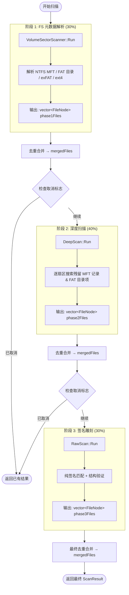

# 统一扫描流水线详细设计

> **文档版本**：v1.0  
> **最后更新**：2026-05-26  
> **模块位置**：`scan/UnifiedVolumeScanner.h/.cpp`

---

## 1. 概述与目标

### 1.1 背景

当前 `UnifiedVolumeScanner::Run()` 仅执行单一阶段——通过 `VolumeSectorScanner` 进行 FS 元数据解析（NTFS MFT / FAT 目录 / exFAT / ext4 inode）。对于格式化后的卷、严重损坏的文件系统或无法识别的分区，元数据扫描几乎无法找到任何文件。

项目中已存在 `DeepScan`（逐扇区搜索残留 MFT 记录与 FAT 目录项）和 `RawScan`（纯签名匹配 + 结构验证的文件雕刻），但它们尚未被集成到统一流水线中。

### 1.2 目标

- **串联三种扫描能力**：将 FS 元数据扫描、DeepScan、RawScan/Carving 串联为单一、自动化的流水线。
- **用户零选择**：用户无需手动选择扫描模式，系统自动按阶段执行，最大化恢复率。
- **统一去重**：三阶段产出的 `FileNode` 经过统一去重后汇入同一个结果集。
- **连贯进度**：UI 侧看到的是一条平滑的 0→100% 进度，附带阶段文本指示。
- **可取消**：任何时刻用户都能取消，取消信号在毫秒级传播到最底层 I/O 循环。

---

## 2. 架构设计

### 2.1 流水线三阶段定义



### 2.2 各阶段详细说明

| 阶段 | 引擎 | 输入 | 输出 | 特点 |
|------|------|------|------|------|
| **阶段 1** | `VolumeSectorScanner` | `SectorReader` + `Partition` | `vector<FileNode>`，含完整路径、时间戳、簇链 | 依赖文件系统结构完整性；速度最快 |
| **阶段 2** | `DeepScan` | `SectorReader` + `Partition` | `vector<FileNode>`，含文件名、部分时间戳、首簇 | 不依赖 FS 全局结构（如 $MFT 起始位置、FAT 表完整性）；逐 512B 步进，速度中等 |
| **阶段 3** | `RawScan` | `SectorReader` + `Partition` + `SignatureDB` | `vector<FileNode>`，合成文件名 `RECOV_<offset>.<ext>` | 不依赖任何文件系统；最慢但覆盖面最广 |

### 2.3 数据流图

```
┌─────────────────────────────────────────────────────────────────┐
│                    UnifiedVolumeScanner::Run()                  │
│                                                                 │
│  SectorReader ─┬─► VolumeSectorScanner ─► phase1Files ──┐      │
│                │                                         │      │
│                ├─► DeepScan             ─► phase2Files ──┤      │
│                │                                         ▼      │
│                └─► RawScan              ─► phase3Files ─► DEDUP │
│                                                           │     │
│                                              ScanResult ◄─┘     │
└─────────────────────────────────────────────────────────────────┘
```

---

## 3. 去重策略

### 3.1 去重键

每个 `FileNode` 产出后计算一个 64 位去重键：

```cpp
uint64_t DeduplicationKey(const FileNode& node)
{
    // 优先使用 rawOffset（精确到字节的磁盘位置）
    uint64_t offset = node.rawOffset;
    if (offset == 0 && !node.clusters.empty()) {
        offset = node.clusters[0]; // 首簇号作为替代
    }
    uint64_t size = node.size;

    // FNV-1a 风格混合
    uint64_t h = 14695981039346656037ULL;
    h ^= offset; h *= 1099511628211ULL;
    h ^= size;   h *= 1099511628211ULL;
    return h;
}
```

### 3.2 阶段间去重规则

1. **按 `(起始扇区偏移, 文件大小)` 的哈希去重**：若后续阶段产出的 `FileNode` 与已有结果的去重键冲突，则丢弃后者。
2. **同名同路径去重**：当路径和文件名完全相同时，优先保留元数据阶段（阶段 1）的结果，因为其拥有最完整的时间戳和簇链信息。
3. **阶段 2 与阶段 3 之间**：阶段 2 的结果优先于阶段 3（签名雕刻文件名为合成名，信息量最少）。

### 3.3 去重数据结构

```cpp
class UnifiedVolumeScanner
{
    // ...
private:
    // 去重集合，存储已接受文件的去重键
    std::unordered_set<uint64_t> deduplicationKeys_;

    // 按路径去重的辅助映射（仅在同路径冲突时使用）
    std::unordered_map<std::wstring, size_t> pathIndex_;

    bool TryInsertDeduplicated(FileNode& node, std::vector<FileNode>& merged);
};
```

### 3.4 去重流程

```cpp
bool UnifiedVolumeScanner::TryInsertDeduplicated(FileNode& node,
                                                  std::vector<FileNode>& merged)
{
    uint64_t key = DeduplicationKey(node);
    if (!deduplicationKeys_.insert(key).second) {
        return false; // 重复，丢弃
    }

    // 同路径检查（可选，仅在 originalPath 非空时启用）
    if (!node.originalPath.empty()) {
        auto it = pathIndex_.find(node.originalPath);
        if (it != pathIndex_.end()) {
            // 已有同路径文件，保留先产出的（更高阶段优先级）
            return false;
        }
        pathIndex_[node.originalPath] = merged.size();
    }

    merged.push_back(std::move(node));
    return true;
}
```

---

## 4. 进度模型

### 4.1 加权进度计算

| 阶段 | 权重 | 全局进度范围 |
|------|------|-------------|
| 阶段 1: FS 元数据解析 | 30% | 0% → 30% |
| 阶段 2: 深度扫描 | 40% | 30% → 70% |
| 阶段 3: 签名雕刻 | 30% | 70% → 100% |

### 4.2 阶段内部进度

每个子引擎的进度回调返回 `ScanProgress`，其中 `scannedBytes / totalBytes` 表示阶段内进度百分比。统一扫描器将其映射到全局进度：

```cpp
int ComputeGlobalPercent(int phase, int localPercent)
{
    // phase: 0=阶段1, 1=阶段2, 2=阶段3
    static constexpr int kBase[]   = { 0, 30, 70 };
    static constexpr int kWeight[] = { 30, 40, 30 };
    return kBase[phase] + (localPercent * kWeight[phase]) / 100;
}
```

### 4.3 阶段文本标签

| 进度区间 | `stageLabel` |
|---------|--------------|
| 0% ~ 30% | `L"阶段 1/3 元数据解析"` |
| 30% ~ 70% | `L"阶段 2/3 深度扫描"` |
| 70% ~ 100% | `L"阶段 3/3 签名雕刻"` |
| 完成 | `L"扫描完成"` |

### 4.4 进度回调适配

```cpp
void UnifiedVolumeScanner::WrapProgressCallback(int phase,
                                                 const ScanProgress& local)
{
    if (!onProgress_) return;

    ScanProgress global;
    global.scannedBytes = local.scannedBytes;
    global.totalBytes   = local.totalBytes;
    global.foundCount   = static_cast<uint32_t>(mergedFiles_.size());
    global.percent      = ComputeGlobalPercent(phase, local.percent);

    static constexpr const wchar_t* kLabels[] = {
        L"阶段 1/3 元数据解析",
        L"阶段 2/3 深度扫描",
        L"阶段 3/3 签名雕刻"
    };
    global.stageLabel = kLabels[phase];

    onProgress_(global);
}
```

---

## 5. 取消传播

### 5.1 取消链路

```
┌──────┐    ┌────────────────────┐    ┌───────────────────────┐    ┌─────────────────────┐
│  UI  │───►│ RecoveryScanWorker │───►│ UnifiedVolumeScanner  │───►│ VolumeSectorScanner │
│      │    │ cancelFlag_        │    │ cancelFlag_ (同一指针) │    │ cancelFlag_         │
└──────┘    └────────────────────┘    │                       │    └─────────────────────┘
                                      │                       │───►│ DeepScan            │
                                      │                       │    │ m_cancelled         │
                                      │                       │    └─────────────────────┘
                                      │                       │───►│ RawScan             │
                                      │                       │    │ m_cancelled         │
                                      └───────────────────────┘    └─────────────────────┘
                                              │
                                              ▼
                                      ┌───────────────┐
                                      │ SectorReader   │
                                      │ cancelFlag_    │
                                      └───────────────┘
```

### 5.2 取消检查点

1. **阶段开始前**：`Run()` 在启动每个子引擎前检查 `cancelFlag_->load()`。
2. **子引擎内部**：
   - `VolumeSectorScanner`：通过 `SectorReader::SetSectorReadCallback` 间接检查。
   - `DeepScan`：通过 `ScanEngine::IsCancelled()` 在每批 128 扇区读取后检查。
   - `RawScan`：通过 `ScanEngine::IsCancelled()` 在每批扇区读取后检查。
3. **SectorReader 读循环**：`SectorReader` 自身持有 `cancelFlag_` 指针，在每次 `ReadSectors` 调用中检查。

### 5.3 取消后的结果处理

- 立即停止当前阶段引擎。
- 已完成阶段的结果保留在 `mergedFiles_` 中。
- 设置 `ScanResult::cancelled = true`。
- 返回已收集到的部分结果，UI 侧可展示"扫描已取消，以下是已找到的文件"。

### 5.4 实现代码

```cpp
ScanResult UnifiedVolumeScanner::Run(SectorReader& reader,
                                      const Partition& partition)
{
    ScanResult result;
    auto isCancelled = [this]() {
        return cancelFlag_ && cancelFlag_->load();
    };

    // ── 阶段 1: FS 元数据解析 ──────────────────────────────────────────
    if (!isCancelled()) {
        RunPhase1(reader, partition, result);
    }

    // ── 阶段 2: 深度扫描 ──────────────────────────────────────────────
    if (!isCancelled() && !config_.skipDeepScan) {
        RunPhase2(reader, partition, result);
    }

    // ── 阶段 3: 签名雕刻 ──────────────────────────────────────────────
    if (!isCancelled() && !config_.skipRawScan) {
        RunPhase3(reader, partition, result);
    }

    result.cancelled = isCancelled();
    result.files = std::move(mergedFiles_);
    result.foundCount = static_cast<uint32_t>(result.files.size());
    return result;
}
```

---

## 6. 配置项

### 6.1 配置结构体

```cpp
struct UnifiedScanConfig
{
    // 最大签名雕刻文件大小（阶段 3），默认 100 MB
    uint64_t maxCarveFileSize = 100ULL * 1024 * 1024;

    // 可选跳过阶段 2（深度扫描），默认 false
    bool skipDeepScan = false;

    // 可选跳过阶段 3（签名雕刻），默认 false
    bool skipRawScan = false;

    // 仅扫描特定文件类型扩展名（为空则不过滤）
    // 影响阶段 3 的 SignatureDB 匹配集
    std::vector<std::wstring> targetExtensions;

    // 阶段权重（可由高级用户调整，默认 30/40/30）
    int phase1Weight = 30;
    int phase2Weight = 40;
    int phase3Weight = 30;
};
```

### 6.2 配置传递

```cpp
class UnifiedVolumeScanner
{
public:
    void SetConfig(const UnifiedScanConfig& config) { config_ = config; }
    // ...
private:
    UnifiedScanConfig config_;
};
```

### 6.3 配置使用场景

| 配置项 | 使用场景 |
|--------|----------|
| `maxCarveFileSize` | 限制签名雕刻阶段的最大输出文件大小，防止误匹配产生超大无效文件 |
| `skipDeepScan` | 用户明确知道文件系统完整时可跳过阶段 2 以加速 |
| `skipRawScan` | 仅需恢复有元数据的文件时跳过阶段 3 |
| `targetExtensions` | 用户仅需恢复特定类型文件（如只找 `.jpg`），过滤 `SignatureDB` 签名集以跳过无关签名匹配 |

---

## 7. 代码变更清单

### 7.1 `UnifiedVolumeScanner` 类修改

#### 新增头文件引用

```cpp
#include "DeepScan.h"
#include "RawScan.h"
#include "SignatureDB.h"
#include <unordered_set>
#include <unordered_map>
```

#### 新增成员

```cpp
class UnifiedVolumeScanner
{
public:
    void SetCancelFlag(std::atomic<bool>* flag) { cancelFlag_ = flag; }
    void SetProgressCallback(ProgressCallback cb) { onProgress_ = std::move(cb); }
    void SetFileFoundCallback(FileFoundCallback cb) { onFileFound_ = std::move(cb); }
    void SetConfig(const UnifiedScanConfig& config) { config_ = config; }

    ScanResult Run(SectorReader& reader, const Partition& partition);

private:
    // 三阶段执行方法
    void RunPhase1(SectorReader& reader, const Partition& partition,
                   ScanResult& result);
    void RunPhase2(SectorReader& reader, const Partition& partition,
                   ScanResult& result);
    void RunPhase3(SectorReader& reader, const Partition& partition,
                   ScanResult& result);

    // 去重辅助
    static uint64_t DeduplicationKey(const FileNode& node);
    bool TryInsertDeduplicated(FileNode& node);

    // 进度适配
    void WrapProgressCallback(int phase, const ScanProgress& local);
    static int ComputeGlobalPercent(int phase, int localPercent,
                                     const UnifiedScanConfig& config);

    // ── 成员变量 ──────────────────────────────────────────────────────
    std::atomic<bool>* cancelFlag_ = nullptr;
    ProgressCallback onProgress_;
    FileFoundCallback onFileFound_;
    UnifiedScanConfig config_;

    // 去重状态（每次 Run() 开始时清空）
    std::unordered_set<uint64_t> deduplicationKeys_;
    std::unordered_map<std::wstring, size_t> pathIndex_;
    std::vector<FileNode> mergedFiles_;
};
```

### 7.2 `UnifiedVolumeScanner::Run()` 修改方案

**修改前**（现有代码）：

```cpp
ScanResult UnifiedVolumeScanner::Run(SectorReader& reader,
                                      const Partition& partition)
{
    VolumeSectorScanner scanner;
    scanner.SetCancelFlag(cancelFlag_);
    // ... 仅执行阶段 1
    ScanResult result = scanner.Run(reader, partition);
    return result;
}
```

**修改后**：

```cpp
ScanResult UnifiedVolumeScanner::Run(SectorReader& reader,
                                      const Partition& partition)
{
    // 清空去重状态
    deduplicationKeys_.clear();
    pathIndex_.clear();
    mergedFiles_.clear();

    ScanResult result;
    auto isCancelled = [this]() {
        return cancelFlag_ && cancelFlag_->load();
    };

    // ── 阶段 1 ──
    if (!isCancelled()) RunPhase1(reader, partition, result);

    // ── 阶段 2 ──
    if (!isCancelled() && !config_.skipDeepScan)
        RunPhase2(reader, partition, result);

    // ── 阶段 3 ──
    if (!isCancelled() && !config_.skipRawScan)
        RunPhase3(reader, partition, result);

    // 汇总
    result.cancelled = isCancelled();
    result.files = std::move(mergedFiles_);
    result.foundCount = static_cast<uint32_t>(result.files.size());

    // 最终进度
    if (onProgress_) {
        ScanProgress done;
        done.stageLabel = L"扫描完成";
        done.percent = 100;
        done.foundCount = result.foundCount;
        done.scannedBytes = result.scannedBytes;
        done.totalBytes = partition.sizeBytes;
        onProgress_(done);
    }

    return result;
}
```

### 7.3 各阶段方法签名

```cpp
void UnifiedVolumeScanner::RunPhase1(SectorReader& reader,
                                      const Partition& partition,
                                      ScanResult& result)
{
    VolumeSectorScanner scanner;
    scanner.SetCancelFlag(cancelFlag_);
    scanner.SetProgressCallback([this](const ScanProgress& p) {
        WrapProgressCallback(0, p);
    });
    scanner.SetFileFoundCallback([this](const FileNode& n) {
        FileNode copy = n;
        if (TryInsertDeduplicated(copy) && onFileFound_) {
            onFileFound_(n);
        }
    });

    ScanResult phase = scanner.Run(reader, partition);
    result.scannedBytes += phase.scannedBytes;
    result.totalRecords += phase.totalRecords;
    result.inUseCount += phase.inUseCount;
}

void UnifiedVolumeScanner::RunPhase2(SectorReader& reader,
                                      const Partition& partition,
                                      ScanResult& result)
{
    DeepScan engine;
    engine.SetCancelCallback([this]() {
        return cancelFlag_ && cancelFlag_->load();
    });
    engine.SetProgressCallback([this](const ScanProgress& p) {
        WrapProgressCallback(1, p);
    });
    engine.SetFileFoundCallback([this](const FileNode& n) {
        FileNode copy = n;
        if (TryInsertDeduplicated(copy) && onFileFound_) {
            onFileFound_(n);
        }
    });

    ScanResult phase = engine.Run(reader, partition);
    result.scannedBytes += phase.scannedBytes;
}

void UnifiedVolumeScanner::RunPhase3(SectorReader& reader,
                                      const Partition& partition,
                                      ScanResult& result)
{
    SignatureDB db;
    // 可选：按 targetExtensions 过滤签名
    if (!config_.targetExtensions.empty()) {
        // 仅保留用户指定的扩展名对应签名
        // （实现：遍历 db.GetAll()，移除不在目标集中的签名）
    }

    RawScan engine(&db);
    engine.SetCancelCallback([this]() {
        return cancelFlag_ && cancelFlag_->load();
    });
    engine.SetProgressCallback([this](const ScanProgress& p) {
        WrapProgressCallback(2, p);
    });
    engine.SetFileFoundCallback([this](const FileNode& n) {
        // 跳过超过 maxCarveFileSize 的文件
        if (n.size > config_.maxCarveFileSize) return;

        FileNode copy = n;
        if (TryInsertDeduplicated(copy) && onFileFound_) {
            onFileFound_(n);
        }
    });

    ScanResult phase = engine.Run(reader, partition);
    result.scannedBytes += phase.scannedBytes;
}
```

### 7.4 Worker 端适配

`RecoveryScanWorker::runVolumeScan()` 需要做以下修改：

1. **进度文本更新**：当前硬编码为 `L"阶段 1/1 元数据解析"`，改为使用 `ScanProgress::stageLabel` 的实际值（已经在 `emitProgressIfNeeded` 中正确处理）。

2. **最终进度标签**：将 `L"阶段 1/1 元数据解析（完成）"` 改为 `L"扫描完成"`。

3. **可选：传递配置**：

```cpp
// 在 scanner 创建后、Run() 之前
UnifiedScanConfig config;
// config 可从 UI 设置页传入
scanner.SetConfig(config);
```

4. **SectorReader 复用**：三个阶段共用同一个 `SectorReader` 实例，需确保各阶段结束后 `SectorReadCallback` 被清除（现有实现已在各引擎的 `Run()` 结尾清除）。

### 7.5 完整变更文件清单

| 文件 | 变更类型 | 说明 |
|------|---------|------|
| `scan/UnifiedVolumeScanner.h` | **修改** | 新增 `RunPhase1/2/3`、去重成员、配置 |
| `scan/UnifiedVolumeScanner.cpp` | **修改** | 重写 `Run()`，实现三阶段串联 |
| `scan/ScanEngine.h` | **无修改** | `UnifiedScanConfig` 定义为独立结构体或放在此处 |
| `scan/UnifiedScanConfig.h` | **新增** | 配置结构体定义 |
| `controllers/RecoveryScanWorker.cpp` | **修改** | 更新进度文本、传递配置 |

---

## 8. 测试计划

### 8.1 DFTT 镜像测试用例

| 测试编号 | 测试镜像 | 测试目标 | 预期结果 |
|---------|---------|---------|---------|
| T-USP-01 | NTFS 正常卷镜像 | 阶段 1 应找到所有已删除文件 | 阶段 2/3 不产生额外结果（去重命中） |
| T-USP-02 | NTFS 格式化后镜像 | 阶段 1 失败或结果极少，阶段 2 应从残留 MFT 找到文件 | 阶段 2 找到的文件数 > 阶段 1 |
| T-USP-03 | FAT32 快速格式化镜像 | 阶段 2 应从残留目录项找到删除文件 | 文件名、大小、首簇正确 |
| T-USP-04 | RAW/未知文件系统镜像 | 阶段 1/2 无结果，阶段 3 应通过签名匹配找到文件 | 找到 JPEG/PNG/PDF 等文件 |
| T-USP-05 | 混合损坏镜像 | 三阶段均有产出 | 总恢复文件数 = 三阶段去重后的并集 |

### 8.2 去重正确性验证

| 测试编号 | 场景 | 验证方法 |
|---------|------|---------|
| T-DDP-01 | 同一文件在阶段 1 和阶段 2 均被发现 | 最终结果中该文件只出现一次，且保留阶段 1 版本（含完整路径和时间戳） |
| T-DDP-02 | 阶段 2 和阶段 3 发现同一区域的数据 | 去重键 `(rawOffset, size)` 命中，保留阶段 2 的结果 |
| T-DDP-03 | 不同大小的文件恰好起始于同一偏移 | 去重键不同（size 不同），两个文件均被保留 |
| T-DDP-04 | 大量文件（> 100,000）的去重性能 | `std::unordered_set` 插入耗时 < 1 秒 |

### 8.3 进度准确性验证

| 测试编号 | 验证内容 | 预期 |
|---------|---------|------|
| T-PRG-01 | 阶段切换时进度跳变 | 阶段 1 结束时进度 = 30%，阶段 2 结束时 = 70% |
| T-PRG-02 | 阶段内进度单调递增 | 进度百分比在每个阶段内严格不减 |
| T-PRG-03 | 取消后进度停止更新 | 取消信号发出后，不再有新的进度回调 |
| T-PRG-04 | 跳过阶段时进度跳跃 | 若 `skipDeepScan=true`，进度从 30% 直接跳到 70% |
| T-PRG-05 | `stageLabel` 正确性 | 每个阶段的 label 文本与预期匹配 |

### 8.4 取消功能验证

| 测试编号 | 场景 | 预期 |
|---------|------|------|
| T-CAN-01 | 阶段 1 进行中取消 | 立即停止，返回已解析文件 |
| T-CAN-02 | 阶段 2 进行中取消 | 阶段 1 结果保留，阶段 2 部分结果保留 |
| T-CAN-03 | 阶段 3 进行中取消 | 阶段 1+2 结果保留，阶段 3 部分结果保留 |
| T-CAN-04 | 连续快速取消/重启 | 无数据竞争，无崩溃 |

### 8.5 性能基准

| 指标 | 目标 |
|------|------|
| 三阶段总耗时 vs 单独执行三个引擎 | 开销 < 5%（去重 + 进度适配） |
| 内存峰值增长 | `deduplicationKeys_` 对 100 万文件约 16 MB，可接受 |
| 去重插入 TPS | > 500 万次/秒（`unordered_set<uint64_t>` 单线程） |
