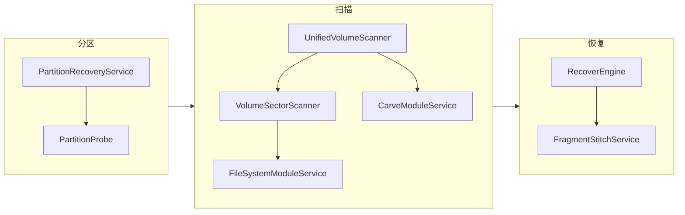

# 恢复能力模块（低耦合）

六项产品能力按模块划分；扫描/恢复流水线只依赖各模块**门面**，不直接 `#include` 具体解析器或 `PartitionProbe` 实现。

## 模块一览

| 能力 | 门面 | 实现 | CTest |
|------|------|------|-------|
| NTFS MFT | `FileSystemModuleService` | `fs/ntfs/NtfsParser` | `CFReDS_NTFS_DFR01` |
| FAT 目录 | 同上 | `fs/fat/FatParser` | `CFReDS_FAT_DFR01` |
| exFAT | 同上 | `fs/exfat/ExfatParser` | DFR Windows 批量 |
| ext4 | 同上 | `fs/ext4/Ext4Parser` | `CFReDS_EXT4_DFR01` + `DFR_Linux_Batch`（htree 目录 + 已删 dentry + 孤儿 inode） |
| 签名雕刻 | `CarveModuleService` | `RawScan` + `SignatureDB` | `DFTT_11_CARVE_FAT` 等 |
| GPT/MBR + 丢失分区 | `PartitionRecoveryService` | `PartitionProbe` | `PartitionRecovery_ProbeImage` |
| 碎片重组 | `FragmentStitchService` | Greedy FAT/NTFS + **GraphCarve** 多 span | `Fragment*QualityGate`, `GraphCarveFragmentStitch` |
| SQLite | `SqliteRecoverService` + `SqliteRepair` | 页级截断/雕刻偏移修复 | `SqliteRecover_PageLevel` |

Office 等仍走 ZIP 容器修复；无独立 MDB 层。

## 1. 文件系统元数据 — `FileSystemModuleService`

**路径：** `scan/FileSystemModuleService.h`

```cpp
#include "scan/FileSystemModuleService.h"

auto fs = FileSystemModuleService::CreateParserForPartition(reader, partition, result);
if (fs && fs->Open(reader, partition)) {
    fs->ScanMetadata();
}
```

- `SupportsFsType` / `ClassifyFsType`：路由 NTFS、FAT、exFAT、ext4。
- `CreateParser`：已知 `partition.fsType` 时直接构造。
- `CreateParserForPartition`：未知类型时按 NTFS → FAT → ext4 试探。

**接入：** `VolumeSectorScanner::Run`（统一扫描阶段 1）。

## 2. 签名雕刻 — `CarveModuleService`

**路径：** `scan/CarveModuleService.h`

```cpp
CarveModuleService::CarveConfig cfg;
cfg.maxFileSize = 100ULL * 1024 * 1024;
cfg.targetExtensions = { L"jpg", L"pdf" };
CarveModuleService::Run(reader, partition, cfg, cancelFlag, onProgress, onFileFound);
```

**接入：** `UnifiedVolumeScanner` 阶段 3；结束后 `CarveGraphMergeService` 对 RAW 多块做 Graph 合并。

## 3. 分区探测与丢失分区 — `PartitionRecoveryService`

**路径：** `disk/PartitionRecoveryService.h`

| API | `PartitionProbe::ProbeMode` | 用途 |
|-----|-----------------------------|------|
| `ProbeVolume` | `Full` | 镜像/物理盘：MBR + GPT + 签名 |
| `ListTablePartitions` | `TableOnly` | 仅分区表 |
| `RecoverLostPartitions` | `LostOnly` | 仅 VBR/超级块签名扫描 |
| `ProbePhysicalDisk` | 同上 | 打开物理盘后调用 `ProbeVolume` |

```cpp
SectorReader reader;
reader.OpenImage(L"path/to/image.dd");
auto lost = PartitionRecoveryService::RecoverLostPartitions(reader, {}, nullptr, nullptr);
```

**底层：** `PartitionProbe::ProbeVolume`（新增，供镜像与物理盘共用）。

## 4. 碎片重组 — `FragmentStitchService`

见 [FRAGMENT_STITCH_MODULE.md](FRAGMENT_STITCH_MODULE.md)。

## 5. SQLite 专门恢复 — `SqliteRecoverService`

见 [SQLITE_RECOVER_MODULE.md](SQLITE_RECOVER_MODULE.md)。

- **发现**：阶段 3 雕刻 / FS 恢复得到 `.db` 文件
- **修复**：文件修复页或 API `RecoverDatabase` 做页类型校验与尾部截断
- **后期**：WAL 合并、坏页跳过后的指针重映射（P1）

## 6. 恢复写出 — `RecoverEngine`

按 `partition.fsType` 解析簇链/块地址（NTFS、FAT/exFAT 绝对扇区、ext4 块号）。不依赖上述门面，但消费各 FS 解析器产出的 `FileNode`。

## 流水线关系



## 测试数据

| 样本 | 路径 |
|------|------|
| NTFS / FAT | `testdata/cfreds/dfr-01-*.dd` |
| ext4 | `testdata/cfreds/dfr-01-ext.dd`（CFReDS 下载） |
| exFAT 批量 | `testdata/DFR/` + `Run-DfrWindowsValidation.ps1` |

## 后期：Graph 碎片拼接

规划见 [ROADMAP_RECOVERY.md](ROADMAP_RECOVERY.md) 与 [FRAGMENT_STITCH_MODULE.md](FRAGMENT_STITCH_MODULE.md)「路线图：Graph」。

## 回归

- 门面路由：`RecoveryModules_FsTypeRouting`
- 分区探测：`PartitionRecovery_ProbeImage`
- ext4：`CFReDS_EXT4_DFR01`（样本缺失时 SKIP）
- SQLite：`SqliteRecover_PageLevel`
- CoreGates：见 `scripts/Regress.ps1`（含上述可选项）
