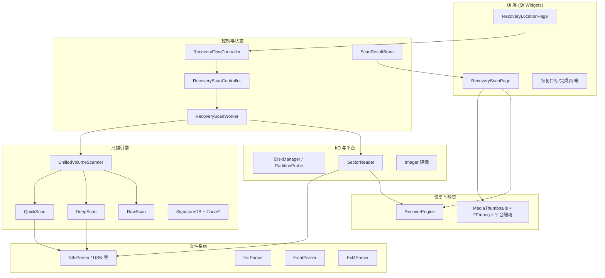

# PhoenixRecover 技术实现方案与详细计划

> **文档类型**: 技术方案与路线图（TDD/实施计划）  
> **与 PRD 关系**: 本文侧重**工程架构、模块划分、技术选型、里程碑与验收指标**；产品需求以根目录 [PRD_PhoenixRecover.md](../PRD_PhoenixRecover.md) 为准。与竞品差距清单见 [EaseUS_Difference_Analysis.md](../EaseUS_Difference_Analysis.md)。  
> **当前代码基线**: C++17、Qt5 Widgets；仓库内已有 `disk/`、`fs/`（NTFS/FAT/exFAT/Ext4）、`scan/`（Unified/Signature/Carve 等子能力）、`recover/RecoverEngine`、`media/`（FFmpeg + Windows WIC/Shell 等），CMake 与 `PhoenixRecover.vcxproj` 并存。

**修订策略**: 里程碑完成或重大架构变更时更新「版本 / 日期」与相关章节。

| 项 | 值 |
|----|-----|
| 文档版本 | 0.2 |
| 最后更新 | 2026-04-02 |

---

## 1. 目标与成功标准

### 1.1 商业/产品目标（技术承载）

- **数据恢复**（与 EaseUS 同类可比的体验方向）：
  - 已删除、格式化、分区不可识别等场景下，在合理时间内给出**可浏览、可过滤**的候选文件列表。
  - **深扫/RAW/签名** 在「无元数据或元数据严重损坏」时仍能产出**带类型、可预览（若适用）**的恢复目标。
- **文件重构**：对**碎片/截断/部分覆盖**的候选，在可判定范围内做**范围估计与（可选）多段拼合**；不承诺 100% 成功。
- **可修复**（子集）：对**部分损坏**的常见容器/媒体（如 ZIP、部分 MP4/MOV、JPEG/PNG 头尾等）提供**可演示的修复/重封装通道**；对「物理损坏/全盘加密」等明确**降级提示**。

### 1.2 非功能目标

| 维度 | 说明 |
|------|------|
| 性能 | 大分区扫描：可控的 **I/O 模式**（顺序优先、大缓冲、限并发），CPU 与内存有**基线与告警**，避免 UI 线程阻塞。 |
| 可取消 | 扫描/深扫/恢复任务可**安全取消**（`atomic<bool>` 或等效，配合 reader 提前返回）。 |
| 安全 | 默认**只读**打开源设备；`RecoverEngine` 对目标盘做**同卷写保护**校验（代码中已有 `ValidateTargetPath` 思想需与全流程打通）。 |
| 跨平台**策略** | **UI/算法核心** 尽量可移植；**块设备/卷枚举与原始读** 按 OS 分实现。详见第 3.4 节。 |
| 可验证性 | 建立**黄金样本 + 自动/半自动基准**（时间、列文件数、抽样准确率），支持回归。 |

### 1.3 「达到 EaseUS 水平」的理性表述

对标头部商业软件是**持续迭代**目标。工程上可落地为**分场景指标**（如：「NTFS 误删、exFAT SD 卡、无分区 carving」分别定义内部 Throughput 与成功列出率），**不**用单一句号承诺全场景等价。

---

## 2. 功能模块与仓库映射

以下为**逻辑模块**与当前/规划**目录**对应关系，便于排期与分工。

### 2.1 总览图

### 2.2 模块说明表

| 逻辑模块 | 职责 | 现状（摘要） | 规划要点 |
|----------|------|--------------|----------|
| **设备与分区** | 枚举卷、分区起止、只读句柄、错误分类 | `disk/DiskManager`、`PartitionProbe`、`Partition`、`SectorReader` 偏 Win | 抽象 `IVolume` / `ISectorReader`；Unix 实现；镜像文件统一走同一 reader |
| **文件系统引擎** | 元数据解析、目录树、FAT/簇链、MFT 等 | `fs/ntfs`、`fs/fat`、`fs/exfat`、`fs/ext4` | 与扫描策略解耦；**第三方选项与决策**见下节 [§3.2.1](#321-文件系统子系统与第三方库结论与选型) |
| **统一扫描流水** | 对外单一入口（无快扫/深扫/RAW UI 分支），内部按阶段执行 FS 元数据、签名与雕刻子能力 | `scan/UnifiedVolumeScanner`、`SignatureDB`、`carve/*` | Worker 仅依赖统一入口；阶段进度和日志可观测；输出统一 `FileNode`/`ScanItem` |
| **结果与内存** | 百万级结果下的存储与展示策略 | `ScanResultStore`、UI 树表 | 虚拟化/分页/延迟加载、索引、搜索真正接到过滤 |
| **恢复引擎** | 从扇区/簇读写到目标文件 | `recover/RecoverEngine` | 与「恢复」页、进度、批量、失败重试、同卷保护全链路 |
| **预览** | 图/视音频缩略与打开 | `media/MediaThumbnails`、FFmpeg、Win WIC/Shell | Linux/mac 补充本机 `ffmpeg` 路径与可选系统工具；大文件限流 |
| **修复管道（规划）** | 格式级修复/重封装 | 尚未独立模块 | 新增 `repair/` 或 `media/repair/`，**按格式** 注册 `IFileRepair` |
| **日志** | 诊断与基准 | `log/Logger.cpp` | 分级、会话 ID、性能计时字段 |

### 2.3 与 EaseUS 差异文档的**技术响应**（跟踪项）

| 差异点 | 技术动作 |
|--------|----------|
| 扫描入口多分支导致维护复杂 | 收敛为单一 `startVolumeScan` → `UnifiedVolumeScanner::Run`；子能力作为内部阶段执行，不暴露模式选择 |
| 无取消/暂停 | 所有长任务持有 `std::atomic<bool>* cancel`；`SectorReader` 读循环可打断 |
| 恢复未闭环 | Controller 连接「恢复」→ `RecoverEngine::RecoverBatch` + 进度条 + 完成页 |
| 表格无多选/批量 | `QTableWidget` → 勾选 model 或 `QTreeView`+Model；`ScanResultStore` 支持选中子集 |
| 无真实筛选/搜索 | 在 Store 上建扩展名/大小/日期的索引或惰性过滤 |
| 大量结果卡顿 | 虚拟列表、分批 append、避免主线程同步插入上万节点 |

（详细交互仍以 PRD 为准。）

---

## 3. 技术架构与选型

### 3.1 核心原则

1. **分层清晰**：**字节/扇区来源** 与 **解释层（FS/雕刻）** 与 **产品动作（恢复/修复）** 分离。  
2. **引擎可插拔**：新格式/新 FS 以**新增翻译单元**为主，少改全局。  
3. **长任务可观测**：每阶段有名称、可取消、可记录**耗时与字节量**。  
4. **许可证先行**：任何 GPL 系依赖先走「法律/发版」评审，再定静态链接/进程隔离方案。

### 3.2 主技术栈（确认项）

| 领域 | 选型 | 说明 |
|------|------|------|
| UI 与应用框架 | **Qt 5.14+**（Widgets） | 与现有工程一致；后续若需 Qt6，单独升级事项。 |
| 语言与构建 | **C++17**；**MSVC**（Windows），**CMake** 跨平台主构建；保留 `.vcxproj` 至团队不需要为止。 |
| 媒体/解码 & 重封装 | **FFmpeg** | 当前以 **QProcess 调 `ffmpeg` 可执行文件** 为主，利于许可证边界清晰；**libav* 静态链接** 列为可选，需与闭源策略统一。 |
| 卷与扇区 | **Win32**（`CreateFile`/`DeviceIoControl` 等） | Linux：`O_RDONLY` 块设备、对齐读；macOS：配合用户权限与 `disk` 子系统（实现细则单独设计）。 |
| 取证/文件系统 | **自研** + 可选 **The Sleuth Kit (TSK)** 等 | 具体候选、许可证与采用阶段见 [§3.2.1](#321-文件系统子系统与第三方库结论与选型)。 |
| 压缩/格式解析（修复向） | **按需** libzip、zlib、自研小解析器 | 不一次性引入大杂烩。 |
| 日志 | 现有 Logger；可选后续 **spdlog** | 需评估与 Qt 日志集成。 |

### 3.2.1 文件系统子系统与第三方库（结论与选型）

#### 是否「需要」引入第三方

| 情况 | 建议 |
|------|------|
| 仅在 **Windows** 上交付，且 `fs/ntfs`、`fs/fat` 等自研已覆盖业务场景 | **不强制**引入；继续通过黄金镜像与单测压质量即可。 |
| 需要 **多平台**（尤其 Linux 读 **NTFS 外接盘**、或需与**取证/司法**流兼容的元数据能力） | **强烈建议**在架构上预留**可插拔 FS 后端**，并评估下方第三方。 |
| 需缩短 **FAT/NTFS/Ext* 在损坏卷/部分元数据** 场景下的排错周期 | 建议以 **The Sleuth Kit (TSK)** 做**对照实现**或**第二数据源**（先 PoC 再合主线）。 |

**结论（工程）**：文件系统层**不**是「全必须第三方」或「全必须自研」二选一；**推荐默认可自研，同时在规划内正式纳入 1–2 个第三方作为可选后端或校验层**，以平衡性能、可维护与许可证成本。

#### 候选第三方库（文件系统/取证向）

> 下表为**选型清单**，**未在仓库中默认可编译链接**；集成方式见「集成策略」与根目录 [CMakeLists.txt](../CMakeLists.txt) 中可选占位注释。

| 库 / 项目 | 主要能力 | 典型接口 | 许可证（概览，以各项目官网为准） | 适用场景与取舍 |
|-----------|----------|----------|----------------------------------|----------------|
| **The Sleuth Kit (TSK)** / **libtsk** | 磁盘镜像/分区、多 FS 的**元数据层**访问；与 fls/icat/ils 等工具同源 | C（`libtsk`） | 多组件 **CPL / LGPL / IBM PL** 等混合，**必须单独做法律评审** | **首选 PoC 对象**：多 FS 统一入口、与深扫/雕刻结果**交叉验证**；闭源发版时常见做法是**动态库**与归属说明，或仅用于**内部分析/对照**分支 |
| **ntfs-3g** / **libntfs-3g** | Linux 等环境下 **NTFS 读写/只读**（视构建） | C | **GPL** 为主 | **Linux 上读 NTFS 外接盘** 时，可作为**与自研 `NtfsParser` 互备**的读路径；与闭源产品组合时需 **GPL 合规**方案（如独立进程/不静态链入闭源主程序等，**须法务定稿**） |
| **e2fsprogs** / **libext2fs** | ext2/3/4 的**库级**块组、inode、目录遍历等 | C | **GPL** / **LGPL**（子组件不同，需核对链接方式） | 仓库已有 [fs/ext4/Ext4Parser.cpp](../fs/ext4/Ext4Parser.cpp)；可评估「继续自研」与「**libext2fs 作校验**」二选一，**避免**双实现长期漂移且无对照测试 |
| **无第三方（自研 only）** | 完全控制性能与发版 | — | 无额外 FS 库许可 | 适合 Windows 单平台首发；**风险**是 NTFS/边缘 case 多、需长期投入测试 **≥** 竞品基线 |

**不推荐**在未有明确需求时一次性引入**多套**同职能库（例如同时 TSK + 全量 ntfs-3g 深入绑定），以免符号冲突、I/O 策略分裂与发版体积极速膨胀。建议 **一条「主实现」+ 一条「对照/备援」**。

#### 与自研 `fs/*` 的关系（推荐架构）

- **统一抽象**（实现名可自定）：`IFsLayoutAccess` 或 `FsMetadataEngine`：输入为「`SectorReader` + 分区起止/类型」，输出为**统一**的「目录项 / inode / MFT 记录 → `FileNode` 流」。
- **实现 A**：现有 `fs/ntfs`、`fs/fat` 等**自研**（性能与产品特性优先）。  
- **实现 B**（可选）：`libtsk` 适配器，可作为统一扫描流水中的**校验/兜底阶段**，或 Linux 缺省 NTFS 时启用。  
- **禁止**：UI 与 `NtfsParser` 细节直接绑死；便于开关第三方。

#### 许可证与发版注意（简化清单）

- **GPL 类**（ntfs-3g、部分 e2fs 链）：**静态链接**进闭源主程序通常不可行；**动态库**、**分进程**、**替代实现** 三选一，**必须由法务确认**。  
- **TSK**：官方以多许可证分发，需保留 **LICENSE / NOTICE**；若仅内部基准工具使用，可减轻产品侧约束（策略由团队定）。

#### 与里程碑的对应

- **阶段 4** 里程碑表中的 **4.4（可选 TSK 集成 PoC）** 与本文一致；在 PoC 前补充 **法务评审** 子任务（见下文章节 6）。  
- 若优先 **Linux 读盘**，可将 **ntfs-3g / libntfs-3g** 评估移入**阶段 6** 的 Unix 子任务，与 `SectorReader` 抽象同一迭代。

#### 参考链接（由集成负责人维护，版本固定）

- The Sleuth Kit: `https://www.sleuthkit.org/sleuthkit/`  
- ntfs-3g: 见发行版 / Tuxera 等维护入口（以实际选型的源码树 LICENSE 为准）  
- e2fsprogs: 见 `https://e2fsprogs.sourceforge.net/` 或各发行包

本地依赖说明的简短索引已放在 [third_party/fs_thirdparty/README.txt](../third_party/fs_thirdparty/README.txt)。

### 3.3 数据模型（建议统一演进）

- **`FileNode`**（已有）：应能表达「仅 carving、无完整路径」的候选，以及多段 `VolumeSlice`（若已支持则扩展**置信度/来源阶段**）。  
- **扫描流**：`FileFoundCallback` 批量推送，避免 per-file 信号风暴。  
- **恢复任务**：`RecoverBatchResult` 已与 `RecoverEngine` 对齐；UI 需展示 `reason`、`targetPath`。

### 3.4 跨平台实现策略

| 层次 | Windows | Linux 桌面 | macOS |
|------|---------|------------|--------|
| 卷枚举 | 现有 `DiskManager` 等 | `lsblk`/`udev` 或 `libblkid`（二选一，避免混用过乱） | `diskutil` + IOKit（按权限模型） |
| 原始读 | `\\.\PhysicalDriveN` / 卷句柄 | `/dev/sdX`、`blkid` 权限提示 | 用户授权、只读 `rdisk` 等 |
| 本地路径/编码 | `std::wstring` 普遍 | `QString`/UTF-8 统一对外的包装层 | 同左 |
| 缩略/预览 | WIC、Shell、FFmpeg | QImage、FFmpeg | 同左，可选 `qlmanage`/`sips` 仅作补充 |

`common/Platform.h` 继续作为 **编译期** OS 宏入口；**运行期**能力用「能力探测」（如 `QProcess::findExecutable("ffmpeg")`）与 UI 提示。

### 3.5 与第三方库引入流程（内控）

1. **必要性评审**（替代自研成本、许可证、包大小）。  
2. **POC**（最小可编译示例 + 一条恢复路径联调）。  
3. **CI/发版**（vcpkg/Conan/子模块版本钉死 + SBOM 记录）。  
4. **回滚策略**（特性开关或编译宏）。

---

## 4. 子系统详细设计要点

### 4.1 扫描子系统

- **统一入口**：`UnifiedVolumeScanner` 作为 Worker **唯一**高层调用点。  
- **阶段 1（FS 元数据）**：优先基于现有 FS 元数据（$MFT、FAT 目录等）快速产出可浏览结果。  
- **阶段 2（扩展深度）**：在同一任务内继续覆盖残留目录项、日志或其他深度来源（按平台/文件系统能力启用）。  
- **阶段 3（签名雕刻）**：`SignatureDB` + `CarveZip`/`CarveMp4` 等；需去重（偏移+长度哈希）与最大长度/熵启发式，抑制垃圾候选。  
- **进度呈现**：UI 展示统一任务进度和当前阶段文本，不再暴露模式切换。

**性能**：  
- 单线程顺序读大缓冲 vs 多线程分带（strip）需基准后定；**默认避免**随机小读。  
- 取消时尽快跳出读循环，避免在深层解析中长时间无响应。

### 4.2 恢复子系统

- `RecoverEngine` 已具备单文件/批量与进度回调；**缺口**是 UI+Controller+线程集成。  
- **预览**：`ReadFileDataPrefix` / `TryPreviewSingleReadSlice` 与 UI 协同，**限制**预览字节，防止内存爆。  
- **同卷写保护**：发版前对「目标路径在源卷」做硬拦截与清晰文案。

### 4.3 修复子系统（新建，分阶段落地）

建议目录：`repair/`（与 `media/` 解耦，避免预览与修复混为一谈）。

| 阶段 | 格式示例 | 手段 |
|------|----------|------|
| v0 | ZIP 截断/中心目录损坏 | 解析与尽力提取；可配合 libzip |
| v0 | MP4/MOV 无法播放但比特流在 | FFmpeg **remux** / `-movflags` 等；需样本回归 |
| v1 | JPEG/PNG 头/尾 | 简单修补与重新封装为可读 |
| 远期 | Office OOXML | 与许可证评估后选型（专库或部分只读恢复） |

每个实现：`bool repair(const QByteArray& in, const QString& outPath, RepairReport& out)`，**不阻塞 UI**。

### 4.4 性能与大数据 UI

- **模型层**：`ScanResultStore` 提供**稳定 ID**、**懒加载**子节点。  
- **视图层**：大结果时优先 **QTableView + QAbstractTableModel** 或虚拟化，替代一次性 `addChild` 万级项。  
- **后台线程**：仅主线程动 UI；扫描线程通过 **queued 信号、批量** 更新。

### 4.5 安全与隐私

- 默认不上传；日志**脱盘序列号/路径**的选项。  
- 从 PRD/法务角度定义「崩溃报告」范围。

---

## 5. 测试与质量保障

| 类型 | 内容 |
|------|------|
| 单元测试 | FS 结构体解析、签名、路径规范化（引入 GoogleTest 或 Catch2 作为可选） |
| 镜像集成测试 | 固定大小镜像文件 + 只读 `SectorReader` 预期文件列表 |
| 性能基准 | 同机同镜像：统一扫描流水跑一轮，并记录分阶段耗时、总墙钟时间与峰值 RSS |
| 对比回归 | 与 EaseUS 同场景**抽样**列文件数、可预览比（**内部**不对外担保） |

---

## 6. 里程碑与详细计划

下列**周数**为**单人全职量级估算**，并行人力可压缩日历时间。每一阶段均含：**交付物、验收、依赖/风险**。

### 阶段 0：基线工程化（约 2–3 周）

| ID | 任务 | 交付物 | 验收标准 |
|----|------|--------|----------|
| 0.1 | 收敛扫描入口到单一 `startVolumeScan` | 设计说明 + 控制层接口简化 | 不再依赖 UI 传入扫描模式 |
| 0.2 | `UnifiedVolumeScanner` 作为 Worker 唯一扫描入口 | 代码 + 注释 | Worker 只依赖统一入口 |
| 0.3 | 取消旗标从 UI → Controller → Worker → `SectorReader` 读循环 | 信号/原子变量贯通 | 大镜像上取消在 **≤2s** 内停止主循环（可配置） |
| 0.4 | 性能埋点：阶段名 + 已读字节 + 墙钟 | Logger 或计时类 | 一次扫描可输出 CSV/日志行 |

**风险**: 若 `SectorReader` 深层阻塞，需拆「可中断读」。

---

### 阶段 1：恢复闭环 v1（约 3–5 周）

| ID | 任务 | 交付物 | 验收标准 |
|----|------|--------|----------|
| 1.1 | 恢复目标目录选择 + 同卷校验 | `RecoverEngine::ValidateTargetPath` 调用 | 选源卷内路径时禁止或强提示 |
| 1.2 | 批量恢复 + 进度条 + 成功/失败列表 | 新页面或对话框 + `RecoverBatchResult` 展示 | 1000 个文件批处理可跑通（小镜像） |
| 1.3 | 恢复完成页/摘要 | 与 PRD 路由一致 | 与流程控制器联通 |

**依赖**: 阶段 0.3 取消能力（大恢复时同样需要）。

---

### 阶段 2：统一扫描流水完善（约 3–4 周）

| ID | 任务 | 交付物 | 验收标准 |
|----|------|--------|----------|
| 2.1 | 统一扫描内部分阶段（FS 元数据 / 扩展深度 / 签名雕刻）执行顺序固化 | 流水线实现 + 配置项 | 同一入口可稳定复现相同阶段顺序 |
| 2.2 | 子阶段进度与总进度 | UI 与回调 | 用户可见「当前阶段」且无模式切换入口 |
| 2.3 | 扫描入口仅保留「开始扫描」动作 | 全流程 | 与产品“单一扫描模式”一致 |

**风险**: 深度阶段与雕刻阶段时间和 I/O 压力较高；需默认参数与**高级选项**（最大文件、仅图片等）后续迭代。

---

### 阶段 3：结果集与体验（约 4–6 周）

| ID | 任务 | 交付物 | 验收标准 |
|----|------|--------|----------|
| 3.1 | 表格多选、勾选、全选 | Model/Widget 改造 | 批量恢复用勾选集 |
| 3.2 | 搜索/筛选接到数据 | 过滤后刷新视图 | 1e5 条级别仍可用（或声明上限） |
| 3.3 | 可恢复性列/图标 | `recoverability` 显示 | 与统一扫描流水输出一致 |
| 3.4 | 大结果性能优化 | 虚拟化/分批 | 与阶段 0.4 指标对比有提升或文档说明瓶颈 |

---

### 阶段 4：深扫与雕刻质量（约 6–10 周，可与阶段 3 部分并行）

| ID | 任务 | 交付物 | 验收标准 |
|----|------|--------|----------|
| 4.1 | 签名库与 carving 统一输出模型 | 文档 + 代码 | 与 `FileNode` 无冲突 |
| 4.2 | 去重与误报控制 | 策略参数 | 黄金集上误报率低于基线（内部表） |
| 4.3 | 简单碎片/多段合（选类型） | 2–3 类格式 | 有样本可演示 |
| 4.4 | 可选 TSK 集成 PoC | 分支/CMake 选项 | 仅当评审通过时合主线 |

---

### 阶段 5：修复子系统 v0（约 3–5 周）

| ID | 任务 | 交付物 | 验收标准 |
|----|------|--------|----------|
| 5.1 | `repair/` 接口 + 异步执行 | 接口 + UI 入口 | 不阻塞主线程 |
| 5.2 | ZIP + MP4 各 1 条主路径 | 样本 + 自动化测试 | 修复成功率在内部集上可统计 |

---

### 阶段 6：Linux / macOS 可发布构建（约 4–8 周，与上层并行时压缩）

| ID | 任务 | 交付物 | 验收标准 |
|----|------|--------|----------|
| 6.1 | `SectorReader` 等平台实现拆分 | `*_unix.cpp` / 宏隔离 | **无 Windows.h 泄漏** 到全平台目标 |
| 6.2 | 卷枚举最小实现 | 只读 + 单设备 | 一条 E2E：选设备 → 扫描 → 列表（可限制 FS） |
| 6.3 | CI：Windows + 至少 1 个 Unix | 脚本 | 推 PR 可编 |

**说明**: 若商业首发仅 Windows，本阶段可整段后移，但**接口设计**应始于阶段 0，避免返工。

---

## 7. 风险与依赖

| 风险 | 缓解 |
|------|------|
| GPL 与闭源发版 | FFmpeg/TSK 等拆进程或动态链 + 法律评审 |
| 深扫过慢/机器卡死 | 默认可调线程、限速、可取消 |
| 多平台盘符/权限导致支持成本高 | 首发聚焦 Windows；Unix 先「专家模式」+ 强提示 |
| 对标期望过高 | 内部指标表 + 分场景 roadmap，版本说明诚实表述能力边界 |

---

## 8. 文档维护

- **负责角色**: 技术负责人 + 各模块 owner。  
- **更新时机**: 每季度或每个 Release；第三方库**主版本**升级必更。  
- **相关文档**: [PRD_PhoenixRecover.md](../PRD_PhoenixRecover.md)、[EaseUS_Difference_Analysis.md](../EaseUS_Difference_Analysis.md)、[STYLE_GUIDE.md](../STYLE_GUIDE.md)、文件系统第三方索引 [../third_party/fs_thirdparty/README.txt](../third_party/fs_thirdparty/README.txt)、实现与修复流水 [DEVELOPMENT_LOG.md](./DEVELOPMENT_LOG.md)、在线测试数据源清单 [TEST_DATA_SOURCES.md](./TEST_DATA_SOURCES.md)、测试执行矩阵 [TEST_EXECUTION_MATRIX.md](./TEST_EXECUTION_MATRIX.md)。

---

*本文档由开发规划整理，具体任务请以issue/项目管理工具中的分解为准。*
